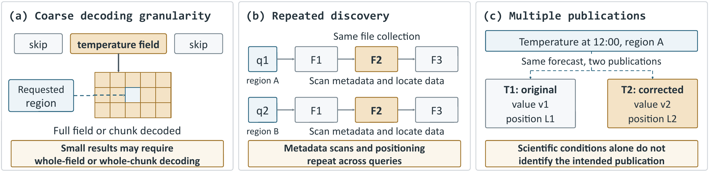
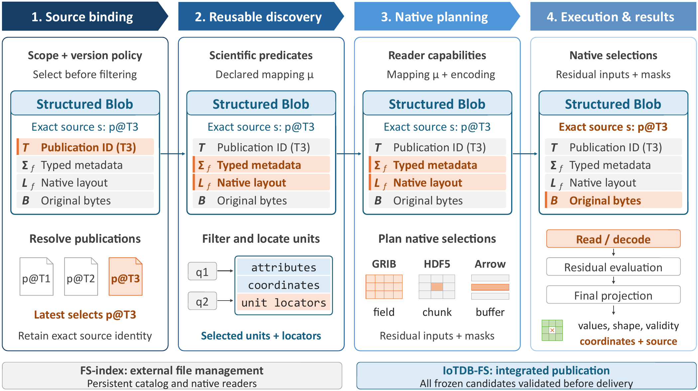

# SciRoute

**From scientific queries to native file access.**

**English** | [简体中文](README.zh-CN.md)

SciRoute unifies scientific selection and publication-version selection through **semantic access paths**. A **Structured Blob** associates scientific and structural metadata, native layout, and original encoded content with an exact published file version. Reusable metadata and locators avoid repeated discovery while preserving the requested interpretation and source.

This repository contains two execution paths: **FS-index**, a standalone index with native readers, and **IoTDB-FS**, a managed filesystem and query runtime backed by IoTDB. It accompanies *SciRoute: From Scientific Queries to Native File Access*. The build targets and runtime retain the IoTDB-FS name.

Start with [standalone FS-index](#standalone-fs-index) for native-library verification, [managed IoTDB-FS](#managed-iotdb-fs) for service setup, or [paper reproduction](#reproducing-the-paper) for workload and measurement requirements.

## Why index scientific files?

Selecting a small scientific result can still require repeated file discovery and decoding a much larger native unit. A reusable index must also keep scientific attributes and access locations bound to the correct file version.



*Latest manuscript Figure 1: coarse decoding granularity, repeated discovery, and multiple publications. Scientific conditions alone do not identify the intended publication.*

## Design

A Structured Blob associates publication identity, typed scientific metadata, native layout, and original bytes. A declared **semantic mapping** establishes quantities, units, coordinates, time conventions, and missing-value rules. Semantic access paths associate these meanings with native units and source-specific locators; reader capabilities determine the physical plan.



*Latest manuscript Figure 2: source binding, reusable discovery, native planning, and execution/results retain the selected source throughout. [Figure provenance](resources/readme/README.md) records the manuscript revision and asset hashes.*

The query path follows four steps:

1. **Bind sources and versions.** Resolve the publication policy before applying scientific predicates. Scientific time and publication order are separate dimensions.
2. **Discover relevant units.** Reuse scientific metadata to select candidate files, messages, datasets, or supported Arrow structures.
3. **Plan by format capability.** Place projection and selection at the catalog or native-access layer, retaining predicates that require decoded values.
4. **Execute and retain provenance.** Read and decode selected units, evaluate residual conditions, and deliver typed results with validity and source identity.

Indexing can save discovery work without reducing every decoding cost. The benefit depends on the file layout, available locators, selection, and reader. Directly addressable Arrow windows, for example, can leave little additional access work for an index to remove.

## Choose an execution path

| | FS-index | IoTDB-FS |
| --- | --- | --- |
| Intended setting | Static or infrequently updated native files | Data held in managed storage with coordinated publication and query execution |
| Discovery | Persistent SQLite metadata index | Versioned catalogs and format adapters |
| Reading | Native GRIB/HDF5 readers | Managed payload access and supported native-file modes |
| Versions and updates | Registered versions; bounded incremental publication and reader refresh | Integrated publication, version selection, and source validation |
| Access control | Supplied by the surrounding system | Validated in managed execution and result access |
| Runtime | No IoTDB service or FUSE mount required | Compatible IoTDB service; FUSE for filesystem access |

FS-index supports incremental maintenance; its intended use is not restricted to immutable, one-time indexes. Its current maintenance interface provides a single-writer catalog protocol within the documented profile, rather than a distributed management service.

### Format coverage

- **GRIB2:** scientific message metadata, message locations, and native decoding; managed queries include supported spatial selections and transformations.
- **HDF5:** dataset metadata and native selections; the managed adapter provides `iotdb-indexed` and explicitly bound `native-hdf5` modes. See the [HDF5 query-mode contract](docs/contracts/hdf5-query-modes.md).
- **Arrow IPC:** the managed adapter supports its declared tabular and nested-array profiles. Scientific roles require verified format or product metadata; arbitrary column names do not establish units or time semantics.

The standalone [`fs_index/`](fs_index/README.md) library currently implements the bounded GRIB/HDF5 profile: six attribute equalities and complete 4,096-element selected units. General HDF5 role mapping and Arrow adaptation are outside that library's current interface. The paper also evaluates separate Arrow sidecars and a large-file Python catalog profile; these are not the same API as the C++ fixed-unit library. Agent-proposed semantic mappings are checked against source records. The evaluated external mapping versions are fixed; dynamic mapping-version propagation is not an evaluated capability.

## Getting started

```bash
git clone https://github.com/thulab/SciRoute.git
cd SciRoute
```

### Standalone FS-index

Use Linux or WSL2, C++17, thread-safe HDF5 **1.14.4**, ecCodes, SQLite, Boost headers, and OpenSSL Crypto. This build does not require IoTDB, FUSE, or Arrow.

```bash
cmake -S fs_index -B build/fs-index \
  -DCMAKE_BUILD_TYPE=Release \
  -DHDF5_DIR=/path/to/hdf5-1.14.4/lib/cmake/hdf5 \
  -DFS_INDEX_BUILD_TESTS=OFF
cmake --build build/fs-index --target fs_index_native --parallel 2
```

The library is `build/fs-index/libfs_index_native.so`. See the [FS-index guide](fs_index/README.md) for the Python API, input requirements, incremental publication, and functional/recovery tests. Test builds enable fault-injection hooks; use a separate Release build with tests disabled for measurements.

### Verify before benchmarking

Two Python-only catalog/handle-lifecycle checks use fixture readers and need no IoTDB service or native library:

```bash
python3 -m unittest fs_index.tests.test_lifecycle fs_index.tests.test_hdf5_handles -v
```

For real GRIB/HDF5 reads and maintenance/recovery gates, install Python **3.10+**, NumPy and h5py, then use a separate test build. The ecCodes sample definitions must be available. Match the native-library profile described in [FS-index](fs_index/README.md); some experiment generators additionally require h5py to load HDF5 1.14.4.

```bash
cmake -S fs_index -B build/fs-index-test \
  -DCMAKE_BUILD_TYPE=Release \
  -DHDF5_DIR=/path/to/hdf5-1.14.4/lib/cmake/hdf5 \
  -DPython3_EXECUTABLE=/path/to/venv/bin/python \
  -DFS_INDEX_BUILD_TESTS=ON
cmake --build build/fs-index-test --target fs_index_native --parallel 2
ctest --test-dir build/fs-index-test --output-on-failure
```

CTest registers `fs_index_native_functional` and `fs_index_maintenance` and supplies the native-library path. These tests generate small fixtures; passing them establishes functional checks, not the paper's performance results. Use the separate tests-disabled build above for measurements.

### Managed IoTDB-FS

The locked Linux CI environment is Ubuntu 22.04 with GCC 11. The root build requires C++17, FUSE, ecCodes, OpenSSL, zlib, **Arrow 21.0.0** with IPC/LZ4/ZSTD, and thread-safe serial **HDF5 1.14.4** with DEFLATE. It also requires the custom **IoTDB C++ SDK with the `OBJECT` extension** and a compatible server; a standard SDK alone is insufficient.

Prepare the dependency prefixes using the [CI dependency guide](ci/README.md) and [dependency lock](ci/dependencies.lock.json), then configure their actual locations:

```bash
cmake -S . -B build \
  -DCMAKE_BUILD_TYPE=Release \
  -DBUILD_TESTS=OFF \
  -DIOTDB_ROOT=/path/to/object-enabled-iotdb-client \
  -DArrow_DIR=/path/to/arrow-21/lib/cmake/Arrow \
  -DHDF5_DIR=/path/to/hdf5-1.14.4/lib/cmake/hdf5
cmake --build build --target iotdb_fs iotdb_fs_web --parallel 2
```

The custom SDK and server are external prerequisites, not bundled binaries. CI expects `IOTDB_SDK_URL` to identify the validated SDK archive. See [PR CI setup](docs/knowledge/pr-ci-design.md) for its configuration.

Create a configuration from [`resources/config.properties`](resources/config.properties), set the database endpoint, credentials, namespace, and mount path for your environment, and start the compatible IoTDB service before mounting:

```bash
cp resources/config.properties /path/to/iotdb-fs.properties
# Edit /path/to/iotdb-fs.properties before starting the service.
export IOTDB_CONFIG_FILE=/path/to/iotdb-fs.properties
mkdir -p /path/to/mount
./build/bin/iotdb_fs -f -o default_permissions /path/to/mount
```

In another terminal, ordinary file operations use the mount path. Optional web browsing is available at `http://127.0.0.1:8080`:

```bash
./build/bin/iotdb_fs_web --host 127.0.0.1 --port 8080 --root /path/to/mount
# Unmount after use (Linux).
fusermount -u /path/to/mount
```

For query syntax, deployment, and configuration details, see the [user manual](docs/knowledge/user_manual/01-overview.md) (Chinese) and the contracts below.

## Reproducing the paper

**Current artifact scope:** this repository provides implementation source, dependency locks, functional tests, and retained experiment drivers. It is **not yet a self-contained archive for reproducing every paper number**. The custom SDK/server, full data and converted inputs, accepted scientific mappings, and some frozen controller/raw-result bundles are external prerequisites. Local paths and historical report names in older protocols are not public download links.

### 1. Pin the implementation and environment

Record `git rev-parse HEAD`, `git status --short`, compiler/OS/CPU details, the [dependency-lock](ci/dependencies.lock.json) digest, loaded native-library versions, binary hashes, and the Python environment (`python3 -m pip freeze`). The lock specifies the native CI profile; it does not lock all experiment Python packages.

The paper's measurements use Ubuntu 24.04.4 LTS, Intel Xeon Gold 6130 at 2.10 GHz, 32 logical CPUs, and 189–378 GiB RAM across campaigns. The CI build profile is Ubuntu 22.04/GCC 11. Local query experiments share two CPU cores across client, native helper, service and DataNode, with a 2 GiB query-memory budget; database memory is separately bounded and differs between campaigns. Use each protocol's actual limits rather than interpreting this as a 2 GiB total-system limit. Remote-access experiments use separate query/storage budgets on one host.

### 2. Prepare data, mappings, and native oracles

| Input family | Required preparation |
| --- | --- |
| Controlled GRIB/HDF5 collections and histories | Retain the corpus/case identities and generators in [FM1](experiments/fixed_matrix/README.md) and [multi-file preparation](experiments/multi_file/README.md). The fixed-unit profile uses four 64×64 units per file, six attribute equalities, and two selected units. A new generated corpus is a new run, not the archived dataset identity. |
| Real GFS GRIB, OISST and GEOS HDF5 | Obtain the exact product files and source digests recorded by the accepted campaign. A product family name or a later daily download is insufficient. Native helpers are under [single-file experiments](experiments/single_file/README.md); full source inventories are not bundled here. |
| Beijing, Jena and the Arrow extension | Use [Beijing source data](https://archive.ics.uci.edu/dataset/501/beijing+multi+site+air+quality+data), [Jena records](https://www.bgc-jena.mpg.de/wetter/weather_data.html), [Appliances](https://archive.ics.uci.edu/dataset/374/appliances+energy+prediction), and the paper's [GIFT-Eval revision](https://huggingface.co/datasets/Salesforce/GiftEval/tree/30841734ac5cfddbd0c3bad6d09d2b6b32becbb0). Exact conversions, sidecars, query manifests and source-record checks are also needed; the complete accepted Arrow experiment bundle is not packaged in this repository. |

Beijing uses flat columns with verified calendar-to-row alignment; Jena uses nested lists and ordinal windows. Do not infer time zones, units or channel meaning from Arrow types alone. Verify source/version identity, shapes, ordering, values, validity masks and applicable coordinates against native readers before accepting a run. Record source hashes and the semantic-mapping revision shared by all paths.

### 3. Select the matching driver and evidence bundle

| Paper study | Retained entry points | Additional requirements / boundary |
| --- | --- | --- |
| Semantic mappings and index construction | [FS-index tests/API](fs_index/README.md), format [contracts](docs/README.md) | Offline rebuild time excludes Agent development; the complete accepted Beijing/Jena adaptation bundle is external. |
| Cross-file and historical queries | [FM1 protocol](experiments/fixed_matrix/README.md), `experiments.fixed_matrix.run`, `hdf5_filesystem`, `multiversion_scan` | Require sealed source collections, native/build bindings and registration receipts. Current source alone does not reconstruct every accepted campaign; strict historical controllers need their matching snapshots. |
| Single-file selections and independent sessions | [Single-file protocol](experiments/single_file/README.md), `section42_20261026/` | Separate managed-mode study; do not relabel it as the three-path FS-index experiment. |
| Warm queries over stored data | [Resident protocol](experiments/resident_table5/README.md), `run.py`, `cache_run.py` | Require existing durable sources, catalogs, owner journals and prior run manifests. HDF5 native-handle measurements are a separate follow-up; managed results retain the original campaign. |
| Incremental publication/maintenance | [M1 protocol](experiments/maintenance_lifecycle/README.md), `run.py`, `supervise.py` | Eight initial files, sixteen updates, 1/10/100 queries per update, three paths and three rounds. Complete traces include copying/publication; they are not marginal indexing costs on already stored DB payloads. |
| Simulated remote access and Arrow three-path extension | Current format/runtime source; campaign-specific external bundles | Accepted network setup/controllers, Arrow sidecars, manifests and raw measurements are not fully distributed here. Remote results are single-host delay emulation, not physical multi-host execution. |

Use the [experiment index](experiments/README.md) to navigate retained helpers. Script names such as `resident_table5` are historical identifiers, not current paper table numbers. Some code under `tests/benchmarks/arrow_training/` supplies native helpers; its older training runs are not substitutes for the paper's Arrow extension.

Run service experiments only in a dedicated environment: their supervisors manage cgroups, process affinity, private mounts and namespaces. Supply new work directories and the required prior manifests; keep service-restoration receipts. Frozen source/binary checks are part of the protocol. Do not bypass them or relabel a new binary as an accepted historical one.

### 4. Preserve the measurement contract

- **Same task:** align scientific mappings, selected publications, units, outputs and validity masks across FS-scan, FS-index and IoTDB-FS. Resolve publication policy before scientific filtering.
- **Separate clocks:** report acquisition/publication, index construction, update/commit, recovery, query serving and finalization under each study's boundary. Already stored managed data must not be charged another complete import for a query-serving comparison. IoTDB-FS couples index construction to publication, so these measurements do not isolate its marginal index-maintenance cost.
- **Cache state:** retain the documented OS/database caches and state whether readers reopen or retain handles. Warm first requests after verification are not cold-cache measurements. Attribute discovery, handle reuse and decoded-state reuse separately.
- **Statistics:** Arrow windows report medians over 30 warm requests; the collection campaign reports medians over 10 filesystem or 40 managed requests per cell, with min–max request ranges. History reports the median and sample SD of three round medians. Independent-session tables use medians, while stored-data session wall/Q and incremental trace totals use arithmetic means of three rounds. Throughput is completed work divided by measured batch time; preserve per-campaign definitions.
- **Acceptance:** preserve all measured samples, failed attempts, source/binary hashes, native-oracle outcomes and resource-restoration status. A query's stages can add before aggregation, but separately aggregated phase medians need not sum to the latency median.

In the paper's controlled 512-file GRIB case, the reported medians are **1984.135 ms (FS-scan), 8.083 ms (FS-index), and 18.177 ms (IoTDB-FS)**: approximately **245× and 109×** speedups over scanning. These are warm, workload-specific comparisons, not default performance guarantees. Known-position Arrow controls approach parity; managed execution can cost more than native access.

## Documentation

[FS-index API](fs_index/README.md) · [Maintenance contract](docs/contracts/fs-index-maintenance-v2.md) · [Query modules](docs/knowledge/query-module-layout.md) · [User manual](docs/knowledge/user_manual/01-overview.md) · [Unit tests](tests/unit/README.md) · [Integration tests](tests/integration/README.md) · [Packaging](packaging/README.md) · [Documentation index](docs/README.md)

## Repository layout

```text
fs_index/            Standalone GRIB/HDF5 index and Python bindings
include/iotdbfs/      C++ interfaces
src/                 Filesystem, storage, query runtime, and format adapters
resources/           Configuration templates and README figures
tests/               Unit, integration, and performance tests
experiments/         Workload definitions and experiment drivers
ci/                  Dependency installation and test tooling
packaging/           Release packaging and runtime tooling
docs/                Current contracts, manuals, and frozen experiment protocol
```

## Contributing and license

Use the documented query/storage contracts and run checks relevant to your change. Contributor and coding-agent guidance is in [AGENTS.md](AGENTS.md). The project is licensed under [Apache License 2.0](LICENSE).
