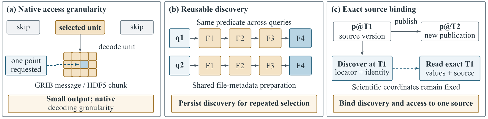
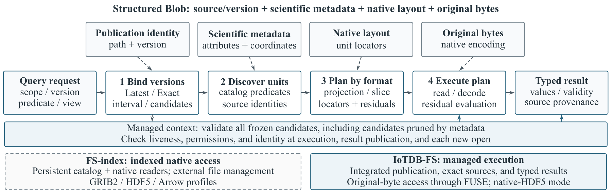

# IoTDB-FS

**面向结构化科学文件的分层查询处理。**

[English](README.md) | **简体中文**

IoTDB-FS 通过统一的 **Structured Blob** 表示关联科学元数据、原生文件布局与精确来源版本，将文件系统访问与数据库查询处理结合起来，支持跨文件、跨发布版本的科学数据选择，同时保留原始编码与来源信息。

仓库包含两条执行路径：**FS-index** 提供独立索引和原生读取；**IoTDB-FS** 提供基于 IoTDB 的受管文件系统与查询运行时。本项目对应研究论文 *Beyond Opaque Byte Streams: Layered Query Processing for Structured Scientific Files*。

## 为什么为科学文件建立索引？

科学查询即使只返回少量结果，也可能需要重复发现文件，并解码远大于结果的原生单元。复用索引还需要保证科学属性与访问位置始终对应正确的文件版本。



*论文动机图：小结果、重复发现与来源身份分别影响查询成本及正确性。*

## 设计

Structured Blob 将发布身份、类型化科学元数据、原生布局和原始字节关联起来。语义索引将科学谓词映射到原生单元，再通过原生索引或补充访问结构定位这些单元。



*论文架构图。图中 FS-index 面板包含论文实验配置；独立组件实际支持的范围见下文。*

查询路径分为四步：

1. **绑定来源和版本。** 先解析发布版本策略，再应用科学谓词。科学时间与发布顺序属于不同维度。
2. **发现相关单元。** 复用科学元数据，选择候选文件、消息、数据集或受支持的 Arrow 结构。
3. **按格式能力规划。** 将投影和选择放到目录层或原生访问层，保留需要解码值才能判断的条件。
4. **执行并保留来源。** 读取、解码选中单元，计算剩余条件，返回带有效性与来源身份的类型化结果。

索引可以减少发现工作，但不一定降低所有解码成本。收益取决于文件布局、可用定位结构、选择条件和读取器。例如，原生即可直接定位的 Arrow 窗口，可能留给额外索引的访问优化空间很小。

## 选择执行路径

| | FS-index | IoTDB-FS |
| --- | --- | --- |
| 适用场景 | 静态或低频更新的原生文件 | 已受管数据，需要协调发布与查询执行 |
| 发现方式 | 持久化 SQLite 元数据索引 | 版本化目录与格式适配器 |
| 读取方式 | 原生 GRIB/HDF5 读取器 | 受管负载访问及受支持的原生文件模式 |
| 版本与更新 | 已注册版本；限定范围内的增量发布与读端刷新 | 集成发布、版本选择与来源验证 |
| 访问控制 | 由外围系统提供 | 在受管执行与结果访问时验证 |
| 运行依赖 | 无需 IoTDB 服务或 FUSE 挂载 | 兼容的 IoTDB 服务；文件系统访问使用 FUSE |

FS-index 支持增量维护，并非只能使用一次性静态索引。当前维护接口在文档限定范围内提供单写者目录协议，分布式管理由外围系统负责。

### 格式范围

- **GRIB2：** 科学消息元数据、消息位置和原生解码；受管查询还支持已实现的空间选择与变换。
- **HDF5：** 数据集元数据与原生选择；受管适配器提供 `iotdb-indexed` 和显式绑定的 `native-hdf5` 模式，见 [HDF5 查询模式契约](docs/contracts/hdf5-query-modes.md)。
- **Arrow IPC：** 受管适配器支持其声明的表格和嵌套数组配置。科学角色必须由核验后的格式或产品元数据确定，不能仅凭任意列名推定单位或时间语义。

独立的 [`fs_index/`](fs_index/README.md) 库当前实现限定的 GRIB/HDF5 配置：六个属性等值条件，以及完整的 4,096 元素选中单元。通用 HDF5 科学角色映射与 Arrow 适配不属于该库当前接口。论文中的 Agent 辅助绑定经过核验，不代表对任意文件自动推断科学语义。

## 快速开始

```bash
git clone https://github.com/thulab/IoTDB-FS.git
cd IoTDB-FS
```

### 独立 FS-index

使用 Linux 或 WSL2、C++17、线程安全的 HDF5 **1.14.4**、ecCodes、SQLite、Boost 头文件及 OpenSSL Crypto。此构建无需 IoTDB、FUSE 或 Arrow。

```bash
cmake -S fs_index -B build/fs-index \
  -DCMAKE_BUILD_TYPE=Release \
  -DHDF5_DIR=/path/to/hdf5-1.14.4/lib/cmake/hdf5 \
  -DFS_INDEX_BUILD_TESTS=OFF
cmake --build build/fs-index --target fs_index_native --parallel 2
```

生成的库为 `build/fs-index/libfs_index_native.so`。Python API、输入要求、增量发布与功能／恢复测试见 [FS-index 指南](fs_index/README.md)。测试构建包含故障注入钩子；正式测量应使用关闭测试的独立 Release 构建。

### 受管 IoTDB-FS

锁定的 Linux CI 环境为 Ubuntu 22.04 和 GCC 11。根目录构建需要 C++17、FUSE、ecCodes、OpenSSL、zlib、启用 IPC/LZ4/ZSTD 的 **Arrow 21.0.0**，以及启用 DEFLATE 的线程安全串行 **HDF5 1.14.4**。还需要支持 **`OBJECT` 扩展的定制 IoTDB C++ SDK** 与兼容服务端；仅标准 SDK 不足以构建本项目。

根据 [CI 依赖指南](ci/README.md) 和 [依赖锁定文件](ci/dependencies.lock.json) 准备依赖前缀，再填写实际位置：

```bash
cmake -S . -B build \
  -DCMAKE_BUILD_TYPE=Release \
  -DBUILD_TESTS=OFF \
  -DIOTDB_ROOT=/path/to/object-enabled-iotdb-client \
  -DArrow_DIR=/path/to/arrow-21/lib/cmake/Arrow \
  -DHDF5_DIR=/path/to/hdf5-1.14.4/lib/cmake/hdf5
cmake --build build --target iotdb_fs iotdb_fs_web --parallel 2
```

定制 SDK 和服务端属于外部前置依赖，仓库不附带其二进制文件。CI 通过 `IOTDB_SDK_URL` 指定核验后的 SDK 压缩包，配置说明见 [PR CI 设计](docs/knowledge/pr-ci-design.md)。

以 [`resources/config.properties`](resources/config.properties) 为模板创建配置，按实际环境设置数据库地址、凭据、命名空间与挂载路径，并在挂载前启动兼容的 IoTDB 服务：

```bash
cp resources/config.properties /path/to/iotdb-fs.properties
# 启动前编辑 /path/to/iotdb-fs.properties。
export IOTDB_CONFIG_FILE=/path/to/iotdb-fs.properties
mkdir -p /path/to/mount
./build/bin/iotdb_fs -f -o default_permissions /path/to/mount
```

在另一个终端通过挂载路径执行普通文件操作。可选 Web 文件浏览入口为 `http://127.0.0.1:8080`：

```bash
./build/bin/iotdb_fs_web --host 127.0.0.1 --port 8080 --root /path/to/mount
# 使用后卸载（Linux）。
fusermount -u /path/to/mount
```

查询语法、部署和详细配置见 [用户手册](docs/knowledge/user_manual/01-overview.md) 及以下契约文档。

## 文档与实验

| 主题 | 入口 |
| --- | --- |
| 科学数据与执行概念 | [领域上下文](CONTEXT.md) |
| 独立索引与维护接口 | [FS-index](fs_index/README.md) · [维护契约](docs/contracts/fs-index-maintenance-v2.md) |
| 查询和适配器组织 | [模块布局](docs/knowledge/query-module-layout.md) |
| 查询调度与结果交付 | [任务调度](docs/contracts/query-task-scheduler.md) · [结果读取](docs/contracts/result-fetch.md) |
| 使用与部署 | [用户手册](docs/knowledge/user_manual/01-overview.md) · [文档索引](docs/README.md) |
| 构建、测试与打包 | [CI](ci/README.md) · [单元测试](tests/unit/README.md) · [集成测试](tests/integration/README.md) · [打包](packaging/README.md) |
| 固定查询负载 | [实验矩阵](experiments/fixed_matrix/README.md) |
| 跨文件与历史查询 | [多文件实验](experiments/multi_file/README.md) · [版本实验](experiments/cross_version/README.md) |
| 维护与已存储数据查询会话 | [维护实验](experiments/maintenance_lifecycle/README.md) · [驻留数据查询](experiments/resident_table5/README.md) |

论文在明确的工作负载下比较 FS-scan、索引原生访问和受管执行。复现需要遵循每组实验记录的数据、依赖版本、查询语义、缓存状态与计时边界。实验目录包含协议和脚本，完整数据集与归档运行输出并非全部随仓库提供。部分配套文档目前仅有中文版。

## 仓库结构

```text
fs_index/            独立 GRIB/HDF5 索引与 Python 绑定
include/iotdbfs/      C++ 接口
src/                 文件系统、存储、查询运行时和格式适配器
resources/           配置模板与 README 插图
tests/               单元、集成与性能测试
experiments/         负载定义与实验驱动
ci/                  依赖安装与测试工具
packaging/           发布打包与运行工具
docs/                契约、手册、计划与报告
```

## 贡献与许可

修改时遵循已有查询／存储契约，并运行与改动相关的检查。贡献者与编程智能体的工作约定见 [AGENTS.md](AGENTS.md)。项目采用 [Apache License 2.0](LICENSE)。
