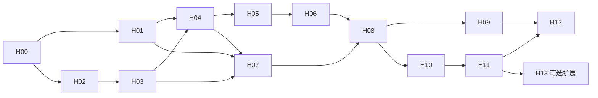

# HDF5 dataset 查询、chunk 复用与迁移：代码实施计划

> 当前依赖（2026-10-12）：HDF5 C 库统一要求 **1.14.4 EXACT**，shared／serial／thread-safe／DEFLATE；官方维护归档为 `1.14.4-3`。安装与校验见 [CI 依赖说明](../../ci/README.md)。下文阶段验收中的 1.14.6 为历史实测版本，未改写其证据或声称在 1.14.4 下重跑。

> 2026-10-06 扩展：当前协议为 layout `/4`，新增 CF 自动绑定、dataset 属性目录及旧 `/1`–`/3` 重摄取。下述 H03–H11 记录保留其当时版本；现行操作见 [dataset 发现与 CF 查询](../contracts/hdf5-dataset-discovery.md)。

日期：2026-10-01  
代码核查基线：`8dd646bb56b977c9667542e4fe80eb7705e6819f`。实施时重新记录 HEAD、工作树差异及源码快照 hash。  
状态：**H00–H11 已完成（H11：2026-10-06）；H12–H13 尚未实施。** 已锁定 HDF5 1.14.6、准备 GWOSC 小型公开基线、完成 Linux/macOS 范围读取与正确性 spike；详见 [H00 实测报告](../reports/hdf5-query-spikes.md)。H01 已固定 [dataset 与多维查询契约](../contracts/hdf5-typed-query.md)，实现 FieldRef 绑定、严格切片与有界 slab 模型。H03 已注册 HDF5 摄取 adapter，完成 layout 与 B/L/Sigma 生命周期；H04 已提供非压缩 typed adapter 与子数组组装，通过真实 QuerySource 查询闭环；H08 已通过隔离 IoTDB/FUSE 接线验收，H10 已完成分段 profile，H11 已完成真实 GWOSC 与受控 fixture 的 A–E 强基线及有界消融，见 [H11 方法与结果](../reports/hdf5-query-benchmark.md)。详见 [H03 layout 与摄取](../contracts/hdf5-layout-ingestion.md)、[H04 typed 执行](../contracts/hdf5-query-execution.md) 和 [H05 过滤器与填充](../contracts/hdf5-filter-decoding.md)。H05 增加 chunk options；H07 当前 layout 为 `/3`，旧 `/1`、`/2` 需重新摄取。H06 已接入公共 chunk cache、批量取数和取消隔离，详见 [H06](../contracts/hdf5-shared-cache.md)。H07 已实现有界对象属性、dimension-scale 候选与显式 GWOSC GPS 秒绑定，详见 [H07](../contracts/hdf5-scientific-binding.md)。H08 已完成有界 schema 描述、显式 GPS 注册与常驻 runtime 接线，详见 [H08 契约和实测](../contracts/hdf5-ipc-runtime.md)。

前置目录整理（2026-10-01）：Arrow 物理模型现位于 `formats/arrow/ArrowQueryModel`，与 `formats/grib/GribQueryModel` 并列；请求坐标单独位于 `ArrowQuerySubject.h`，不改变 `physical_array` 协议。见 [模块布局](../knowledge/query-module-layout.md)。这项现有代码整理不计为任何 HDF5 Hxx 阶段完成。

组织方式参照 [Arrow 实施计划](arrow-query-implementation-plan.md)，使用独立的 H00–H13 编号，不沿用其中的完成勾选或实验结论。代码与 Git 操作遵守 [AGENTS.md](../../AGENTS.md)：不新增兼容层，不执行 Git 写操作；未确定的代码设计在进入对应实施单元前确认。已完成阶段以各阶段契约文档为准；H09 的管理入口与统一报告协议已经通过小规模隔离迁移验收，其余未实施阶段中的名称仍为拟定名称。

## 1. 目标、假设与交付范围

### 1.1 目标

在保留 HDF5 原始文件字节的前提下，建立文件内 dataset 的结构描述与 chunk／连续区间定位，通过既有 typed query 返回有界多维子集，并在同一运行时复用解码结果。核心数据流为：

```text
精确文件版本
  → dataset 绑定与能力检查
  → 数组轴上的矩形选择
  → 相交 chunk／连续范围
  → 有界读取、解码与共享 fragment
  → 子数组组装
  → QueryBatch + DomainDescriptor
  → 既有 Arrow IPC / typed result / FUSE 入口
```

沿用 GRIB 的 `QueryFragment(projection, predicate, slices)`、`FormatQueryAdapter` 与私有物理计划；不把 HDF5 dataset 伪装成 Arrow batch/row/List，也不把 chunk 当作独立自描述的 GRIB message。原始 HDF5 的普通文件读写与 typed 查询能力分开管理。

### 1.2 里程碑

| 里程碑 | 必需单元 | 完成含义 |
| --- | --- | --- |
| M1：原生查询闭环 | H00–H05 | 已支持 profile 的文件可摄取；精确版本＋单 dataset＋矩形索引选择与原生 oracle 一致；压缩与非压缩路径均有实际范围 trace。 |
| M2：共享与生产入口 | H06–H08 | chunk 共享、预算、取消、元数据边界和现有 IPC/socket/FUSE 接线通过；不同 dataset 不发生身份混淆。 |
| M3：可复现交付 | H09–H12 | 迁移小规模 live 验收、分段 profile、强 FS 对照、构建和运行手册齐全。性能正收益不是功能完成的先决条件，负结果必须保留。 |
| E1：派生布局／训练扩展 | H13，另行确认范围 | 只有原生路径测量证实必要时才重分块或接入训练；不是 M1–M3 的隐藏前提。 |

### 1.3 首版建议 profile

- 已完成写入的单一物理 HDF5 文件，摄取后以不可变 published version 查询；不提供运行中 SWMR/MPI 写入快照语义。
- 一次查询绑定一个 dataset。多 dataset 查询通过独立请求验证，不隐式按 shape 对齐或 join。
- rank 1–3 的规则数组，当前 extent 固定于版本；具有 unlimited max extent 的 dataset 可以读取其已发布 current extent，不因此开放在线 append 查询。
- 标准 IEEE Float32/Float64，保留位宽；大小端显式处理。其他数值类型可以在 H00 的真实样本审计后纳入决策，不默认按长度将任意 HDF5 datatype 解释成 IEEE float。
- contiguous、chunked；compact、scalar dataspace、null dataspace 等在 inventory 中识别，首版 typed 能力明确拒绝。零长度的 simple dataspace 与 null dataspace 分开处理。
- 单位步长、按轴索引的半开矩形区间。默认完整轴，支持空区间；不支持点集合、stride/block hyperslab、区域引用或任意 selection union。
- 无过滤器，以及经 H05 验证的 DEFLATE、shuffle、Fletcher32 和它们的明确组合。其他过滤器、插件、scale-offset 等列为不支持，不默默跳过实际应用的过滤步骤。
- 只遍历本文件内受支持的对象／hard link，限制深度、对象数、属性大小和路径长度；首版不解析 soft link，并显式报告其不可查询。禁止跟随 external link、外部 raw storage、VDS、family/split/subfiling 等额外物理来源。

该 profile 已通过 **H00 受限样本验证，并在 H01 固定物理查询契约**，不是对任意 HDF5 文件的支持承诺。HDF4 不属于本计划。

### 1.4 研究假设的边界

HDF5 原生已支持子集读取、chunk 定位和 cache，因此“加一个 chunk 索引”不是系统收益的充分条件。研究对象是 **文件布局＋查询负载＋缓存／并发条件**，不是 `.h5` 后缀。原生 chunk 错位的读取／解码放大不能仅靠索引消除。

分开检验：原生单元定位收益、共享解码收益、跨文件目录筛选收益、重分块布局收益，以及完整 typed 服务的额外成本。参考 [Arrow 布局与系统对照结果](../reports/arrow-layout-system-control-results-20260930.md)，不将 FS 同样获得的布局改善计为 IoTDB-FS 独有收益。支持矩阵、优化矩阵与论文结论分别验收。

## 2. 实施基线与决策门

用户已确认：以 GRIB typed 框架为基础、物理结构与科学语义分离，并在 H01 确认采用 FieldRef 绑定 dataset（不新增 subject）。H00 已固定 HDF5 1.14.6 与 GWOSC GW150914 小型公开基线。以下列出已收敛契约及后续阶段仍需确认的决策。

| 门 | 建议基线 | 确认时点 |
| --- | --- | --- |
| B1：格式与类型 | 已固定 1.3 受限 profile；H00 基线为 GWOSC H1/L1 `/strain/Strain`。 | H00/H01 已完成 |
| B2：dataset 身份 | 用户已确认 `hdf5.value:<规范百分号编码 UTF-8 路径>` 与 `hdf5.axis.0/1/2`；一个值 dataset、UInt64 半开切片，无独立 subject。 | H01 已完成 |
| B3：不支持内容 | 可辨识、可有界检查但不在 profile 的合法对象保留字节与能力原因，不因某 dataset 不可查询而拒绝整个文件；已识别结构损坏／真实 I/O 错误必须明确报告，不伪装成“不支持”。超大索引的降级规则见 3.3。 | H03 |
| B4：库与执行 | libhdf5 负责结构解析；只读 VFD 对接 source。受限 raw chunk decoder 负责优化热路径；VFD＋H5Dread 仅作正确性参照和显式诊断路径，不能隐藏回退。 | H00/H02/H05 |
| B5：缓存单元 | chunked 首先使用完整 decoded chunk；contiguous 用与请求无关的固定逻辑 tile。key 包含 source、dataset、布局与解码身份，不含用户窗口。 | H04/H06 |
| B6：批量与并发 | HDF5 adapter 显式使用已存在的有界多范围能力；允许配置 1/2/4 路读取。保持普通 Arrow/GRIB 的现有执行策略不变。 | H06 |
| B7：结果 | 按末轴最快的 C 顺序展平，保留 N-D origin/shape；一个 batch 是完整矩形子块，整个 cursor 确定顺序、无重无漏。 | H01/H04 |
| B8：缺失和填充 | 物理 profile 不把 fill value、NaN 或 `_FillValue` 属性自动变成 NULL；只有明确且验证过的科学语义绑定才产生 mask。未定义填充状态不返回伪造零值。 | H01/H05/H07 |
| B9：语义 | 物理轴为 ordinal；layout /3 保存属性与候选。用户确认显式 GWOSC GPS 秒绑定、精确规则网格及变长单位属性由配置声明；无自动通用时间／经纬度推断。 | H07 已完成 |
| B10：迁移 | 用户已确认：本机 namespace writer lock＋其他主机停写；首版仅迁移 inventory 时最新 pass-through，生成新版本且 B 不变。旧 HDF5 layout `/1`、`/2` 只报告 `requires_reingestion`，不自动升级。统一报告必须绑定 endpoint/database、策略、layout 与 inventory SHA，旧 A12 报告拒绝并重新 inventory。 | H09 已完成 |

## 3. 模块、契约和资源边界

### 3.1 现有能力与新增职责

| 模块 | 当前事实 | HDF5 工作 |
| --- | --- | --- |
| `FormatAdapter` / `IngestionModule` | 同步稳定 `FormatSource`；B、L、Sigma 与 publication 分离。 | 新增 HDF5 detection/session；不复制第二份整文件、不使用尚未发布的 backend 作为解析 source。 |
| `QuerySource` / `QueryPlanningContext` | 精确版本、storage namespace、范围读、单次规划共享状态。 | 保存必要的 dataset/index 页规划状态；不每次解析整个 L。 |
| `QueryFragment` / `QueryBatch` | 投影、谓词、轴区间、N-D shape/origin 已存在。 | H01 明确 dataset 字段与轴契约；新增内容局限于已确认缺口。 |
| `DecodedFragmentCache` / `QueryRuntime` | 通用 fragment、single-flight、lease、批量 miss 认领与资源统计已存在。 | 新增 HDF5 provider/keys，复用既有服务，不复制一套缓存。 |
| typed frontend / result store / FUSE | 注册、授权、有界 IPC、结果生命周期已存在。 | 添加 HDF5 schema/请求支持与 live 回归，不新建 HDF5 专用 socket 服务。 |
| `ReingestionService` / `MigrationCli` / `MigrationJournal` | H09 已抽取格式中立的 publication、hash、journal、resume；Arrow/HDF5 检查位于各自 `ReingestionPolicy`，不再公开 `ArrowMigration*` 公共类型。 | HDF5 inventory 与 CLI 已实现；冻结目标 layout hash、报告 namespace 绑定、双本机锁和恢复回归已加入；Linux/live 小规模验收通过。 |
| Arrow training | snapshot/coverage/assembler 显式依赖 Arrow layout 和 fragment。 | 不作为 HDF5 核心依赖；H13 才讨论格式中立化。 |

建议新增文件（声明在 `include/iotdbfs/formats/hdf5/`，实现位于 `src/formats/hdf5/`；不要求每一概念机械拆成一个类）：

| 文件组 | 职责 |
| --- | --- |
| `Hdf5Layout.h/.cpp` | 有版本的文件目录、dataset 类型／shape／存储布局、chunk 页索引、严格有界解析。 |
| `Hdf5FormatAdapter.h/.cpp` | 内容识别、摄取 artifacts、格式身份与有限 Sigma/xattrs。 |
| `Hdf5SourceDriver.h/.cpp` | libhdf5 只读 VFD、source 生命周期、错误传播、读取 trace 和库调用管理。 |
| `Hdf5QueryModel.h/.cpp` | 字段编码、dataset 绑定、轴 schema/capabilities、profile 检查。 |
| `Hdf5FormatQueryAdapter.h/.cpp` | 规划／执行入口，私有计划，输出 cursor。 |
| `Hdf5QueryKernel.h/.cpp` | 选择区域与存储单元求交、范围生成、子数组组装。 |
| `Hdf5FragmentProvider.h/.cpp` | canonical chunk/tile 解码、公共 cache 和批量 miss 接线。 |
| `Hdf5SemanticBinding.h/.cpp`（按需） | H07 已确定产品的坐标／属性绑定；无实际产品时不添加空壳。 |

修改 `cmake/QueryModules.cmake` 增加 HDF5 source group，生产库和单测共同引用；核对 CMake、CI 依赖锁、安装／激活／打包与非 CMake source list。`main.cpp` 只做注册和 runtime 注入。libhdf5 handle/类型不得泄漏到 query core 公共契约中。

### 3.2 请求与输出契约

H01 已固定以下概念；具体 FieldRef 编码、JSON schema、错误与空结果语义见 [HDF5 typed query 契约](../contracts/hdf5-typed-query.md)：

```text
source = exact(path, version)
dataset = /observations/temperature
projection = [value]                    # 可加 axis0/axis1/axis2 坐标列
selection = axis0:[100,124), axis1:[20,28), axis2:[30,38)
output = Float32 或 Float64（跟随原生类型）
```

上面是概念表达，不是 socket JSON。`dataset` 仅由值字段身份确定；不存在独立 dataset subject，也不借用 `physical_array.record_batch_index/row_index`。实际语法可通过通用请求验证，真实数据执行仍待 H02–H08。

- 必须在完整字段校验前绑定 dataset，利用已有 `capabilities(context, fragment)` 入口生成其 schema；精确文件不存在、文件被 selector 筛除、dataset 不存在、存在但 profile 不支持分别处理。文件被筛除保持现有空选择语义；零匹配 source 的 schema 按核心既有行为明示，不虚构 dataset schema。
- 矩形区间检查 rank、重复轴、端点、溢出和越界；不静默裁剪。未指定轴为 `[0, extent)`。空选择返回有 dataset schema 的零行结果且不读 value payload。
- 首版不提供任意 value predicate。仅对实际验证的属性运算或轴切片声明能力；`Exact` 指结果语义精确，不宣称压缩块内精确字节读取。
- 一个请求仅一个值 dataset；不同形状／坐标系的多个 dataset 不隐式广播。后续多变量投影必须有显式对齐契约。
- `DomainDescriptor` 使用 ordinal 轴、子块 origin/shape；值按 C 顺序展平。游标切分为满足目标 rows/bytes 的矩形 slab，必要时沿最内轴进一步分段；不能将跨行的一段平面 buffer 假报为一个连续矩形。
- 即使坐标不在投影中，也保留 domain；若未来 residual filter 使结果不规则，不能保留虚假的 dense shape，应显式输出坐标并使用合适 domain。
- dataset 身份、精确 source、轴顺序、dtype、物理／语义视图标识和必要 provenance 写入一次性描述，不按元素重复长路径。变换后的值必须声明变换，不能只给 hash。

### 3.3 Layout 与物理单位

H03 已冻结 `IOTDBFS-HDF5-LAYOUT/1\n` 有界二进制协议，采用对象／hard-link 图目录和按 dataset 分页的 chunk 索引；目录及各页保存 SHA-256、记录数和范围。编码细节见 [H03 契约](../contracts/hdf5-layout-ingestion.md)。包含：

1. 文件 profile、payload 大小、格式／解析器版本，以及目录完整性状态。
2. dataset 稳定对象身份与 hard-link 路径映射、datatype 描述、rank/current extent、存储类型、支持状态及原因。
3. allocation/fill-time 配置和存储分配状态；contiguous 基址与长度（未分配可为 `HADDR_UNDEF`）；chunked 的 chunk shape、filter pipeline/参数、fill 配置、已分配 chunk 坐标／地址／编码大小／filter mask。
4. 页目录、页记录数／边界、完整性校验与 dataset 索引完成标记。逻辑 chunk 不存在与某页未读取／未建立索引必须可区分。

dataset 身份限定在精确源版本内，不能将 libhdf5 临时 handle 或进程地址持久化。hard-link alias 对同一个对象共享缓存；路径解析仍按请求可见路径检查。对象图遍历有去重和深度上限。

HDF5 chunk 地址应转换成实际文件绝对 offset，验证 user block 和锁定版本 API 的地址口径；不手写猜测 B-tree/fractal heap 等结构。`H5Dget_chunk_info*` / `H5Dchunk_iter` 的选用和地址差异在 H00 以 fixtures 验证。[HDF5 dataset API](https://support.hdfgroup.org/documentation/hdf5/latest/group___h5_d.html)

layout **构建上限** 与 **查询实际读取上限** 分开：现有 `write_layout(vector)` 仍要求一次持有最终 artifacts，不能因为磁盘编码分了页就声称构建内存已流式化。首版允许有界构建、按 dataset/chunk 页读取；超过构建上限时记录 `index_unavailable: resource_limit` 并保留原字节，相关查询明确失败，不生成假完整索引。若实际产品必需超限规模，再单独设计流式 layout publication，不能仅无限调大限额。

页目录本身有硬上限；查询按页边界做候选剪枝并验证实际 chunk 相交，所有候选页扫描计入规划预算。不声称对任意高维选择都具有最优索引复杂度。未分配 chunk 只有在对应索引完整、填充语义明确时才能合成值；缺页、截断或不完整索引必须报错。

### 3.4 读取、解码与缓存

- chunked 的 canonical 单位首先是原生 chunk；多个重叠选择复用完整解码块。压缩块不能按所需元素比例假定少读／少解压。
- contiguous 按 C 顺序生成范围，采用稳定 tile 而非请求边界作为 key。精确裁剪在组装阶段完成，tile over-read 单列。
- cache key 至少包含 backend namespace、精确 source/version、manifest/layout 身份、dataset 身份、chunk 坐标或 tile 范围、解码 profile；不包含请求 ID、实验 ID、输出投影或窗口边界。
- 稳定内容身份与进程内 namespace 分开。持久绑定／实验清单不得使用 pid 或随机 runtime 值；进程缓存严格隔离 backend。首版不增加可跨存储复用的外部 sidecar。
- `get_batch()` 只加载本次认领的 miss；先去重、合并真实连续范围，再把不连续范围放入传输波次。当前 storage 每批至多 64 ranges、8 MiB；大 chunk 可以分段运输后一次解码，压缩完整单位的临时／驻留内存仍须可容纳。
- 并发读取只在受控独立 session 能力和资源配额内执行。libhdf5 的构建选项、线程安全与实际串行锁在 H00 测量；线程安全不等于调用可并行。不得从持有公共 cache mutex 的回调进入阻塞库调用。
- 服务实际 I/O/解码与每请求逻辑需求、输出预算分开。缓存命中仍受请求需求／输出上限限制；一个等待者取消不能取消其他等待者。
- 声明并计费 encoded buffer、decoded buffer、codec scratch、字节序转换和最终输出；避免库内部 raw chunk cache 与公共 cache 保留两份不可见副本。libhdf5 自身未能精确核算的 metadata/control 内存单列配置限额及 RSS，不将应用 buffer 预算描述成全进程硬 RSS 上限。

## 4. 可独立审阅的实现单元

每阶段记录改动、测试命令、实际平台、结果与证据 hash；未执行项保持未勾选。下面以勾选状态区分已执行与未来验收要求；H00 的实际证据见独立报告。

### H00 — 固定依赖、数据 profile 与 I/O spike

依赖：无；B1/B4 在本单元收敛。范围：依赖锁、构建调查、fixture generator、只读实验 probe。

- [x] 记录源码、当前测试入口、Linux/macOS toolchain、libhdf5/h5py/NumPy 实际版本、动态链接与 codec；选定并锁定 release/checksum、API 和构建选项，不直接依赖系统最新库。
- [x] 验证项目 C++17 与 HDF5 C API 的链接方式；若 CMake 查找需要启用 C 语言，明确修改项目配置。同时检查生产、单测、CI installer 和 release source/link 清单。
- [x] 生成确定值、rank 1/2/3、contiguous/chunked、大小端、压缩、边缘 chunk、稀疏分配、user block、hard links、空 extent 和 unsupported profiles 的小 fixtures。
- [x] 用原生 H5Dread/h5py 生成值 oracle；另用公式数组校验，避免 custom decoder 与同库 oracle 的共同错误被掩盖。记录库版本和文件 hash。
- [x] 验证 chunk 地址／filter mask／大小可定位真实文件范围；比较 raw chunk 路径与 H5Dread，不把 raw chunk 当作已解码数组。
- [x] 选择至少一个公开、可复现的实际 HDF5 产品；冻结许可、下载版本、hash、dataset、shape、chunking、filters、文件数量和真实查询需求。不能仅用重新打包 Electricity 的 HDF5 证明格式泛化。
- [x] 审计服务器可用空间、隔离 namespace 与构建目录；不默认既有 Arrow 环境已安装正确 HDF5，也不修改现有实验挂载。

完成条件：形成 `docs/reports/hdf5-query-spikes.md`，可重建 fixtures、原生读取与范围 trace；明确首版 profile、库版本、真实产品以及尚不支持项。无公开产品时可继续功能开发，但 H11 的真实工作负载验收不能通过。

### H01 — dataset 与多维查询契约

依赖：H00 profile，B2/B7/B8。范围：`Hdf5QueryModel`，必要的 query core/parser 定点修改。

- [x] 固定 dataset 字段编码或显式 subject，记录路径 escaping、Unicode、轴 ID、字段碰撞和错误语义；不依赖后缀或拼接未经解析的查询字符串。
- [x] 实现单精确 source/version＋单 dataset＋rank 1–3 矩形索引契约；与 `physical_array` 同时出现时拒绝，避免两套地址相互覆盖。
- [x] 明确 Float32/64 输出、空选择、零 extent、缺 dataset、unsupported dtype、重复维度、上下界和算术溢出。
- [x] 用 fake dataset provider 验证字段绑定前的 capabilities、strict schema、domain 和 cursor slab 顺序；不先引入时间／经纬度猜测。
- [x] GRIB 的现有 schema/predicate/slice 与 Arrow batch/row 查询保持原语义；若核心接口变化，更新所有实现与调用者，不保留未经请求的兼容入口。

完成条件：契约文档与请求／结果测试可评审，真实文件 decoder 尚未完成也不得混淆其状态。

### H02 — 只读 source driver 与有界库访问

依赖：H00。范围：`Hdf5SourceDriver`、recording source tests。

当前进度（2026-10-01）：进程生命周期内禁用动态插件的策略已获用户确认；只读 VFD、预算、诊断 probe 与回归测试完成。Linux 1,051/1,051 单元测试，Linux/macOS 各 176/176 oracle/拒绝用例，以及 macOS ASan/UBSan 验证通过。范围与证据见 [H02 source driver](../contracts/hdf5-source-driver.md)。

- [x] 用 VFD 将 source size/offset reads 接入 libhdf5；正确处理 EOF/EOA、零读、读取失败、handle 关闭与 callback 生命周期，任何 C callback 都不能让 C++ 异常跨 ABI。
- [x] 摄取 source 只在同步 ingest 期间有效；执行 source 持有固定版本能力。禁止借本机临时路径打开同名文件或在挂载内部递归访问自身 FUSE。
- [x] 配置并记录库 metadata/raw cache；对应用可控内存设限，超过支持边界明确失败。不得以全文件内存 image 代替范围读。
- [x] 外部文件解析和动态 filter plugin 加载有显式限制；不允许打开未授权额外来源。配置污染、取消、失败后 error stack 与句柄清理有回归。
- [x] 实现诊断用 VFD＋H5Dread 子集 probe，分开 metadata 与 raw data 读取；记录被库预取的数据，不把它称为最小范围读取。

完成条件：本地 buffer 与 QuerySource fake 得到一致原生值；越界、短读、取消、对象关闭、不同源同名路径隔离通过。该参照路径不计为公共 decoded cache 已接入。[VFD 接口依据](https://support.hdfgroup.org/documentation/hdf5/latest/_v_f_l_t_n.html)

### H03 — HDF5 layout、摄取与身份注册

依赖：H00/H02，B3。范围：`Hdf5Layout`、`Hdf5FormatAdapter`、registry、有限 Sigma/xattrs。

当前进度（2026-10-01）：二进制 layout 契约已获用户确认并实现；新增 39 项测试通过，Linux 1,090/1,090 单元测试通过；Linux/macOS 各 59/59 摄取 oracle、macOS ASan/UBSan 59/59、两平台 H02 176/176 回归通过。真实 IoTDB/FUSE 验收尚未运行，现有实验挂载未改动。详见 [H03 实现与证据](../contracts/hdf5-layout-ingestion.md)。

- [x] 按内容识别；考虑签名位于 0 或合法 user-block 后的位置，对所有探测读先检查 size。0/3 字节文件、错误后缀、rename 与其他 adapter 继续探测的回归通过。[文件格式依据](https://support.hdfgroup.org/documentation/hdf5/latest/_f_m_t4.html)
- [x] 通过 libhdf5 建立有界对象目录，保存受支持 dataset 的结构与 chunk/contiguous 定位；多 hard links 去重，循环图与超限遍历明确处理。
- [x] 为每个 dataset 保存 queryable/unavailable 原因；未知 filter 或 unsupported datatype 不阻止其他受支持 dataset 的查询，也不声称整个文件全部验证。
- [x] 实现 3.3 的目录／索引页编码、完整性校验、记录计数和版本检查；校验所有范围在 payload 内，维数、元素数、bytes 乘积无溢出。
- [x] 验证稀疏分配和完整索引证明；删去一个已分配 chunk 记录不能被误认为 fill。未分配 contiguous 的 `HADDR_UNDEF` 不直接视为坏 offset，按 allocation/fill-time 状态描述；布局损坏必须被校验检出。
- [x] 摄取只复制一次 B；附加结构读与用户属性读单独计量，不为基础索引扫描全部数值或计算 min/max。
- [x] 复用 B/L/Sigma/publication 生命周期与失败补偿；有限文件级 Sigma 保存 format、profile、dataset counts 等，完整 dataset 元数据放 L，不用 capped 列表作精确否定筛选。

完成条件：真实 fixtures 摄取后 B hash 不变；读取不到未发布半成品；结构损坏、unsupported、索引超限、真实 I/O 错误可区分。大 layout 查询只触及必要目录／页，仍受请求预算约束。

### H04 — 非压缩 typed 查询与子数组组装

依赖：H01/H03。范围：`Hdf5FormatQueryAdapter`、`Hdf5QueryKernel`、初始 fragment provider。

当前进度（2026-10-01）：18 项新增回归测试、Linux 1,114/1,114 CTest（含 1,108 单测）、Linux/macOS 各 203/203 oracle、macOS ASan/UBSan 203/203 通过。查询执行不调用 H5Dread；本阶段显式拒绝 filters 与需要 fill 合成的选择。H08 mount/socket 接线尚未实施，现有实验挂载未变动。详见 [H04 实现与验证](../contracts/hdf5-query-execution.md)。

- [x] capabilities/prepare 共享已解析绑定和索引页；计划固定 source/version/revision、layout、dataset/type 身份，execute 验证所需身份而非每次完整读 L。
- [x] contiguous 计算稳定 tile/ranges；chunked 枚举与请求相交的 chunk；组装顺序与物理读取排序分离。
- [x] 实现无过滤器 Float32/64、大小端、非零 origin、跨行／跨 chunk／边缘 chunk；不读其他 dataset 的 values。
- [x] 完整块与局部块以相同位置规则组装，不遗漏、不重复；每 batch 的 shape 乘积等于行数，最后一批和空选择正确。
- [x] 结果不重复长路径；精确 source 与 dataset provenance、轴顺序和 dtype 可由消费者重建。
- [x] source 删除、错误版本、坏布局、payload 截断、输出预算超限、运行中取消明确传播。

完成条件：非压缩 rank 1–3 oracle 和 recording range 测试通过；真实 QuerySource 查询闭环，不以 VFD 读取整数组代替优化路径。

### H05 — 过滤器、填充与可复用解码

依赖：H04，B4/B8。范围：HDF5 decoder、受限 codec integration。

当前进度（2026-10-01）：Linux 全量 1,144/1,144 CTest 通过；Linux/macOS H05 各 416/416 oracle，macOS ASan/UBSan 416/416 通过。H03 `/2` 摄取回归各 59/59、H04 非压缩回归各 185/185 通过。已支持公开 GWOSC 的 Fletcher32→DEFLATE；M1 格式查询闭环通过，真实 IoTDB/FUSE 接线与性能对照仍留待后续阶段。详见 [H05 实现与证据](../contracts/hdf5-filter-decoding.md)。

- [x] 解码器按 dataset pipeline 与每 chunk filter mask 确认实际应用的 filters，以逆序还原；只接受经验证的参数／顺序组合，未知组合显式不支持。
- [x] 支持约定的 DEFLATE/shuffle/Fletcher32；校验 checksum、字节序、解压后长度、尾部数据和边缘块规则，错误不能输出部分值。
- [x] 解压前根据已校验 shape/dtype 预留内存，限制编码输入和 codec 输出；超大 chunk 即使能分段运输，也不能绕过完整解码单位的内存上限。
- [x] 区分有效零值、NaN、正负零、明确 fill、未分配与未定义填充。同时覆盖缺失 chunk 和尚未分配的 contiguous dataset；核对 allocation/fill-time 策略，仅合成原生契约保证的确定值。未定义填充／无法证明有效的未写状态明确不支持，不能伪造零值。无显式语义映射时不把 fill 转换为 NULL 或 mask。
- [x] 受支持 chunk 不因不同输出区域重复建立 decoder；不调用任意动态插件，也不静默回退到全文件／全 dataset H5Dread。

完成条件：每个受支持 filter 组合和 mask 情况对照原生读取；corruption/截断/超限/部分边缘过滤均有负例。达到 M1，记录逻辑有用字节、实际读取字节和解压字节三个口径。

### H06 — 公共 chunk cache、批量读取与并发隔离

依赖：H04/H05，B5/B6。范围：Hdf5FragmentProvider、现有 QueryRuntime 注入与必要的通用 capability 接口。

当前进度（2026-10-01）：19 项新缓存集成测试＋9 项 transport 测试；Linux 全量 1,174/1,174 CTest 通过，含既有 Arrow/GRIB/cache 回归。Linux/macOS H06 各 13/13 配置（65 场景），H04 各 185/185、H05 各 416/416；macOS sanitizer 同样通过。并发验收使用人工调用延迟和记录型 backend，1/2/4 为每 producer 的上限，真实 IoTDB session/RPC 耗时尚待 H08 服务接线后测量。执行不调用 libhdf5；已独立记录 codec wall／线程 CPU time。详见 [H06 契约与证据](../contracts/hdf5-shared-cache.md)。

- [x] 接入公共 `get/get_batch`，相同 dataset chunk 的不同矩形查询共享 immutable lease；hard-link alias 共享，跨源／backend／版本不共享。
- [x] 合并缺失范围并按 64 ranges/8 MiB 等实际 transport 限额拆波；超大单块分段、partial read 和批量失败保持完整 fragment 原子发布。
- [x] 保持请求输出顺序；重叠请求的 miss 只认领一次，剩余缓存命中不重新复制整个块；分别测 single-flight、cache reuse 与 range batching。
- [x] 并发 1/2/4 可配置，不先假定收益；记录真实调用峰值、I/O wall time 与 codec 线程 CPU。优化查询不调用 libhdf5，失败／取消释放配额；真实 IoTDB session 池等待留待 H08 服务接线后单独测量。
- [x] cache 以 bytes 控制主容量并显式配置 entry 上限；验证大量小块不会在字节预算尚空时因默认 entry cap 反复解码。全 pinned、retired、超大块场景保持真实计费。
- [x] 回归最后 waiter 取消后重试、旧 worker 不覆盖新 entry、后来 waiter 的期限、单请求失败不污染其他查询；producer 不捕获首个请求预算。

完成条件：同一 daemon 多请求对相同 resident chunk 只解码一次，记录真实范围／调用／字节／copy 与 memory；回归既有 Arrow cache 测试。普通 Arrow/GRIB 策略不被 HDF5 批处理顺带改写。

### H07 — 元数据与科学语义绑定

依赖：H01/H03/H04。范围：有限 Sigma、dataset 目录与已确定产品的 binding。

- [ ] 文件级 Sigma 与 dataset 级 attributes 明确分层；属性类型、缺失、大小限制和完整性状态可观察，不能用字符串化比较替代 typed 比较。
- [ ] 物理轴默认 ordinal；读取 dimension scales/属性仅收集候选，不根据路径名 `time/lat/temperature` 自动赋予语义。
- [ ] 若 H00 产品需要坐标查询，显式绑定变量、单位、坐标 dataset、轴顺序与时间单位；验证长度、一致性、单调性和转换溢出。曲线网格／不规则坐标若未实现须明确拒绝。
- [ ] 坐标索引构建属于额外准备和 I/O，单独预算／profile；基础 chunk 索引不依赖扫描整个 values dataset。
- [ ] 跨文件语义查询只有在目录和能力实现后才开放；现有 file catalog 不会因为新增 L 自动变成 dataset 元数据数据库索引。无实际下推证据时报告为目录遍历。

完成条件：物理模式与可选语义模式独立验证；只有实际实现的映射声明能力。无产品绑定时可交付物理查询和明确的 unsupported 行为，但不能声称已完成通用经纬度／时间查询。

当前实现（2026-10-01）：用户确认 layout `/3`（旧 `/1`、`/2` 重新摄取）；属性按对象保存 typed 值、名称目录完整性和读取状态。固定长度字符串按 padding／UTF-8 校验，变长属性不做无界读取。公开 GWOSC 由显式配置声明 GPS／second，校验数值属性和可读取的固定字符串；`hdf5.coord.gps_seconds` 为 Float64，以二分映射到 ordinal，保持公共 chunk cache 共享。dimension scales 只记录反向候选，不声明通用坐标查询。无新增坐标 dataset 扫描和坐标索引 I/O，准备阶段只读 L；无跨文件 dataset 属性下推，报告为目录遍历。Linux 全量 1,201/1,201 CTest；Linux/macOS H07 各 38/38，macOS 168 项专项与 38 项 oracle sanitizer 通过，H03–H06 回归通过。详见 [H07 契约与验证](../contracts/hdf5-scientific-binding.md)。

### H08 — 有界 IPC、注册协议和 FUSE 运行时

依赖：H04–H07。范围：现有 encoder/frontend/socket/bridge/main 与集成测试。

- [x] 注册 HDF5 ingestion/query adapter，复用一个常驻 runtime；B2 沿用 FieldRef，无新 subject；JSON 严格验证显式 GPS binding 与大小限制。
- [x] 复用 QueryBatch IPC，传递 dataset、轴顺序、shape/origin/source 描述；PyArrow 消费者可按 slab 坐标无歧义重建数组。
- [x] 编码限额与 result store 上限一致；空结果、预算超限、发布失败、route TTL 和结果回收不遗留不可回收句柄。
- [x] 使用既有不可变结果路径与 mmap 支持；验证 stat/open/read/seek/mmap/EOF/concurrent open，不因 TTL 重物化改变同一结果路径的字节。
- [x] 每个实际 source 先授权再返回数据，即使 decoded cache 命中也不绕过权限；补充组与权限缓存失效规则沿用现有实现并回归。
- [x] malformed 请求、等待超时、客户端断开和取消有服务级测试；不承诺只靠客户端断开就能中断底层不可取消的库调用。

完成条件已达到：隔离 live mount 中原文件与 typed IPC 均可读，PyArrow 按 descriptor/slab 重建结果与 h5py oracle 逐字节一致。第二个独立客户端 0 解码、0 payload 读取；两个并发客户端的 9 个 chunk 总计只解码 9 次。达到 M2。

当前进度（2026-10-02）：Linux 全量 1,219/1,219 CTest；macOS socket 45/45，HDF5 socket ASan/UBSan 13/13。真实挂载覆盖补充组、撤权、mmap、源删除后的旧 handle、新 open 拒绝和最后关闭回收。用户确认打开期间固定属性可见；`default_permissions` 下 access(R_OK) 仅为提示，以实际 open 授权为准。修复 Float64 次正规数解析和 FUSE 已打开结果的属性刷新。详见 [H08 实现与证据](../contracts/hdf5-ipc-runtime.md)。

### H09 — 旧 HDF5 数据重摄取与操作流程

依赖：H03/H05/H08，B10。范围：migration 公共流程抽取、HDF5 inventory 策略与管理入口。

- [x] 审计 `ReingestionService` 的 Arrow 依赖，抽取 namespace publication、hash、journal、resume 公共流程；Arrow 格式检查保留在 Arrow 策略中，HDF5 独立提供检查。更新现有调用者和回归，不复制第二份迁移状态机。
- [x] inventory 按内容／实际已注册 identity 分类最新候选、历史版本、已索引、部分 queryable、不支持和错误，记录 dataset profiles；不凭 `.h5` 后缀迁移。
- [x] 共用本机 writer lock，操作手册要求其他主机停写，迁移期间禁止源 rename/unlink。读 handle 不等于 backend 保留承诺，本机锁不等于分布式互斥。
- [x] 原 source 经 IngestionModule 重摄取为新版本，B hash 完全相同；不转换 HDF5、不重分块、不改旧版本，也不使用只复制旧 layout 的版本 copy helper。
- [x] 写入前 journal 精确目标 key，摄取前／发布前验证源和 latest；resume 不只相信成功标记，重验 source/target hash、identity、layout 和 inode。
- [x] 小 fixture 和公开实际样本验证 old/new exact version、普通读取和 typed 查询；发布后验证失败的目标单列报告，不承诺尚未实现的自动 latest rollback。

代码入口为 `iotdb_fs hdf5-migrate inventory|run|resume --report DIR [--path /exact/path]`，与 Arrow 共用报告协议和恢复实现。旧 `/1`、`/2` 仅报告，不进入候选。新协议拒绝旧 A12 报告，校验 namespace／策略／layout 与冻结 inventory digest 后才允许修复日志尾部。未发布旧尝试保留，重试版本高于全部预留 key；状态读取失败不当作目标不存在。

当前进度（2026-10-02）：**H09 完成**。Linux 全量 **1,254/1,254 CTest**，公共 journal 本地 **15/15 ASan/UBSan**，策略／服务 **26/26 普通及 ASan/UBSan**。独立数据库 `h09probe1790939889dbfc1f` 的 [live summary](../results/hdf5-h09-20261002/live-summary.json) 为 `ok=true`：8 个 inventory 版本中仅迁移 2 个最新 pass-through 候选，包含 4,473 B 压缩 fixture 与 1,040,592 B GWOSC H1，旧/新 B hash 相同；实际写入前 SIGKILL、模拟发布后日志丢失、重复恢复、latest 冲突、FUSE 精确版本读取和 typed 子集均通过。旧 layout 标记只用于分类验收，不代表真实旧编码升级。Arrow 合成双层 List 的 A12 live 重构回归同样通过，覆盖 typed／训练窗口、resume 和 writer lock；405 项远端源码／构建／测试文件 hash 与本地一致。操作手册、版本明细与日志见 [H09 迁移手册](../knowledge/hdf5-data-migration.md)。批量迁移与其他 namespace 仍须另外记录授权和范围。

### H10 — Profile 与可解释成本模型

依赖：H06/H08；可与 H09 独立推进。范围：probe、profile 字段、汇总与证据脚本。

- [x] 分离一次性摄取／索引构建、reader setup、查询注册／准备、metadata/layout I/O、payload I/O、解压、类型转换、组装、授权、IPC、发布、客户端读取／重建。
- [x] 记录 API 调用数、range 数、唯一／实际 chunk decode、编码字节／解码字节／有用输出字节、合并 over-read、cache eviction/redecode、copy、峰值及 pinned/inflight memory。
- [x] 测量库锁等待、工作队列、session 并行度；并发子阶段累计时长不能直接相加当作 wall time，保留父子计时归属。
- [x] recording source 与 IoTDB 后端指标交叉校验；mmap 建立视图与 page fault 成本分开解释，返回字节不冒充物理磁盘 I/O。
- [x] 提供固定 workload trace、逐请求原始记录和独立 summary；检出缺样本、重复样本、校验失败。零读取／零解码断言只用于明确预热且相关工作集完整驻留的 decoded-cache 实验；cache-off、encoded-only 和超预算工作集按各自预期报告 decode/eviction/redecode，不将正常暖遍解码误判为失败。

完成条件：可以根据实测回答延迟由 bytes、ranges、解压、metadata 还是服务协议主导，不仅给总 wall time。

**已完成（2026-10-03）**：见 [H10 profile 契约与实测](../knowledge/hdf5-query-profile.md) 和 [18 配置实验清单](../results/hdf5-h10-20261003/verified-runs/experiment.json)。压缩小 fixture 与真实 GWOSC H1 共有 12 个 recording 配置／48 请求、6 个独立 live daemon 配置／24 请求，全部通过值哈希、精确 source、固定 trace 完整性和后端 I/O 交叉校验；Linux CTest 1,264/1,264。64 MiB 预算下 retain 暖查询均零 payload／decode，主动驱逐能测得 redecode。live 暖请求仍有 7 次 metadata query＋4 次 layout read，固定元数据／服务路径成本主导本轮小 trace；IPC 和 codec 占时较小。配置 p=2/4 时实际 active peak 仍为 1，不声称并行加速；首次 Python 转换包含未剥离的惰性初始化，不能解释为纯拷贝成本。各配置仅单次 trace，不给统计显著性或 FS 胜负结论；cache-off、encoded-only 和容量压力未配置。额外 IoTDBClient 写入型集成因新数据库无法分配 SchemaRegionGroups，停在 seed 阶段，未声称通过；已有 H09 精确版本上的只读验收完整通过。

### H11 — 与 GRIB 对齐的强基线和消融

依赖：H00 真实产品、H10。范围：`tests/benchmarks/hdf5_query/`、方法与结果文档。

- [x] 冻结同 source/version、dataset、selection、输出 dtype/shape、结果校验、codec 和内存预算；统一选择率口径并保留 GRIB 对齐的局部读／过滤／并发类别。
- [x] 先单客户端无谓词矩形读取，再压缩、跨文件元数据选择和重叠多客户端；不用先人为重分块的文件掩盖原始布局成本。跨文件实验由 runner 先执行已实现的 catalog／目录筛选，再生成一组精确 source＋dataset 子查询，保留文件和结果身份，不要求 H01 一条请求跨源 join。筛选使用的字段／来源必须真实可用；分别报告目录遍历与实际索引剪枝，FS 同样允许使用预建目录。
- [x] 执行第 6 节的 A–E 路径和 profile 分解，区分 native HDF5＋FS、同 reader 的后端差异、typed 端到端差异。
- [x] 完成逐请求波次前驱逐／encoded cache／decoded cache、单范围／多范围、1/2/4 并发、chunk shape 和工作集／预算比的有界消融。当前公共 runtime 无完全绕过 cache 的入口，故逐波次驱逐保留波次内复用，明确不称为 true cache-off；encoded cache 仅为 benchmark 诊断实现。
- [x] cold-app 与 warm-app 分开；OS/数据库缓存状态独立记录，不宣称重启客户端等于冷磁盘。重复运行交错顺序，暖多遍先在独立重复内聚合，避免伪重复。
- [x] 多客户端比较相同总内存与原生多进程能力；提供共享缓存 FS 对照或明确其缺失。不要用 Python 线程串行行为证明数据库固有并行优势。
- [x] 全部性能结果绑定正确性校验、源码／二进制／配置 hash；记录负结果和适用范围，不预设 HDF5 必须优于 FS。

完成条件：发布可复现报告，能分别判断原生布局是否错位、共享是否节省解码，以及完整系统是否获益。仅合成数据通过不代表科学产品泛化成立。

**已完成（2026-10-06）**：见 [H11 强基线报告](../reports/hdf5-query-benchmark.md)、[36 配置汇总](../results/hdf5-h11-20261006/final/aggregate.json) 和 [源码／结果复核](../results/hdf5-h11-20261006/verification.json)。12 个配置各独立运行 3 轮，共 108 条路径运行、18,120 次 owned-array 查询，值／shape／dtype 校验通过；本地离线重汇总与服务器结果一致。Linux CTest 1,265/1,265，runner 验证测试 24/24。基础 30 查询 trace 暖态均值 A/B/C/D/E 为 0.938/13.967/1.341/583.548/1,749.565 ms；当前小型常驻工作集没有 IoTDB-FS 性能正收益。B/D 暖态 payload 与 decode 均为零，但每遍仍访问 120 次 layout、30 次 manifest，固定规划与元数据成本占主导。单范围 p=2/4 实测并行峰值为 2/4；多范围配置峰值仍为 1，不把其暖态波动解释为并行加速。并发仅覆盖重叠读取；不声明冷磁盘、统计显著性或所有科学 HDF5 产品泛化。新数据库因 IoTDB 直接内存不足无法创建 SchemaRegion，最终使用已有隔离 H09 namespace 内全新唯一路径，未调整数据库配置或现有 Arrow/GRIB 挂载；见 [环境审计](../results/hdf5-h11-20261006/environment-audit.json)。

### H12 — 包装、运行手册和最终验收

依赖：H09/H11。范围：CI、打包、文档、support matrix。

- [ ] 执行生产与单测构建、相关 sanitizer、依赖安装器测试和隔离 live 验收；记录实际测试数，不复用 Arrow 历史测试数作为 HDF5 证据。
- [ ] 明确已验证平台／libhdf5版本／codec/profile，未运行平台标为未验证；依赖和许可证进入 release 清单。
- [ ] 更新查询、迁移、限制、资源配置和恢复文档，给出真正可执行的请求／命令例子。
- [ ] 核对完整验收矩阵、原始 evidence 路径、hash 和已知限制；不存在用 fallback 成功替代优化路径验收的项目。

完成条件：M1–M3 的功能与证据全部落实；性能未胜出可以完成工程交付，但论文不得声称系统优势。

### H13 — 按证据启动的派生布局与训练扩展（不计入核心交付）

依赖：H11 结论及用户确认。

- [ ] 若原生 chunk 与真实分析方向不匹配，构建独立 rechunk/transpose artifact，保持原 B；记录源内容／精确版本、变换、dtype/shape、artifact hash、构建／验证／摄取时间和额外空间。
- [ ] 同时在 FS 和 IoTDB-FS 使用完全相同的原始／派生字节和读取器，运行 backend × layout 的 2×2 对照。只有布局收益时明确如此报告。
- [ ] 从真实轨迹评估 amortization、版本更新与失效；不能以复用已有 artifact 的零摄取计时估算完整生命周期回本。
- [ ] 若确需训练，先抽取格式中立的物理 binding／fragment provider 边界，再接现有窗口／视图语义；不让 HDF5 依赖 Arrow batch/row，不复制 scheduler、snapshot identity 或缺失策略。
- [ ] 训练或跨文件连续窗口必须有真实序列／时间／变量映射；不为了制造性能收益任意拼接文件或序列。

## 5. 依赖顺序与首次编码切片



各 Hxx 的依赖文字为完整约束。依赖调查／fixtures 与接口草案可以并行，固定接口后可以并行迁移和 profile；不得让多个实施者同时修改 core/parser/main 的同一边界。

**第一次编码只取 H00 → H01/H02 → H03/H04 的最小纵向切片：** 两个 dataset `/a` 与 `/b`；`/a` 为 shape `[5,7,9]`、chunk `[2,3,4]` 的未压缩 Float32，值由可重建公式生成。查询 `/a[1:5,2:7,3:9]`，跨三个轴的 chunk 边界且包含边缘块；`/b` 使用不同 shape。核对值、C 顺序、slab origin/shape、访问的 chunk 集合，并证明未读取 `/b` value payload。随后加入相同内容的 contiguous、大小端、空选择和 Float64，再进入 H05 压缩／填充和 H06 跨请求复用。

此切片不需要地理语义、训练器或大型公开数据，不应先实现完整 HDF5 通用选择代数。

## 6. 验收矩阵与实验路径

### 6.1 功能和故障验收

| 编号 | 核心验证 | 阶段 |
| --- | --- | --- |
| HQ01 | 小文件、多格式探测、user block、错误后缀／rename；真实读失败不吞掉。 | H02/H03 |
| HQ02 | B hash、发布失败不可见、unsupported dataset 不阻止合法普通读取。 | H03 |
| HQ03 | dataset 不存在／不支持、hard-link alias、路径 escaping、跨 backend/version 隔离。 | H01/H03/H06 |
| HQ04 | rank 1–3、非零 origin、跨轴边界、尾块、C 顺序、empty/zero extent、溢出。 | H01/H04 |
| HQ05 | contiguous 与 chunked 输出一致，只读目标依赖，transport 分段不改变值。 | H04/H06 |
| HQ06 | Float32/64、大小端、NaN/Inf/负零；每种 filter 顺序／mask／checksum 的正负例。 | H05 |
| HQ07 | 显式／默认可确定 fill、未定义 fill、未分配 chunk/contiguous、allocation/fill-time、边缘块和缺失索引页区分。 | H03/H05 |
| HQ08 | 错 layout version、删记录、坏计数／页／offset、payload 截断、超大索引与压缩炸弹。 | H03/H05 |
| HQ09 | 首次／重叠／并发查询 single-flight，取消重试、deadline、失败不污染、内存真实回收。 | H06 |
| HQ10 | 小 chunk 大数量、全 pinned、超预算块、batch 部分失败、队列与 session 上限。 | H06 |
| HQ11 | 单位／坐标不猜测，属性缺失不误剪枝，不规则坐标无虚假支持。 | H07 |
| HQ12 | IPC 重建、编码限额、权限、TTL、stat/open/mmap、结果回收与错误映射。 | H08 |
| HQ13 | old/new B hash、最新版本冲突、journal 中断／resume、writer lock。 | H09 |
| HQ14 | profile 口径、trace 一致、原生 oracle、强基线、同总预算并发、缺测检出。 | H10/H11 |

sanitizer 重点覆盖 native callback 生命周期、过滤器输入、并发缓存和取消；不把 ASan/UBSan 通过描述成线程竞态已验证。

### 6.2 A–E 路径

沿用已有 GRIB/Arrow 实验的分层比较目的；以下为 **HDF5 专用路径定义**，不能仅按字母与历史报告直接拼接。H11 在报告中逐项映射旧实验对应路径与不同契约。

| 路径 | 存储与读取 | 作用 |
| --- | --- | --- |
| A | 普通 FS＋原生 libhdf5/h5py hyperslab；合理 metadata/chunk cache；复用打开对象。 | 强原生基线，不强制整文件读。 |
| B | 普通 FS＋同一 Hdf5QueryKernel/布局索引/raw decoder/有界 cache。 | 与 D 控制相同 reader，分离后端成本；外部索引构建单列。 |
| C | IoTDB-FS 普通文件路径＋与 A 相同原生 reader。 | 测普通文件访问层附加成本，不启用 typed 查询。 |
| D | IoTDB QuerySource＋与 B 相同 kernel/decoder/cache，直接数组消费。 | 测相同布局／算法下的后端差异，绕开结果 IPC/FUSE 物化。 |
| E | 生产 typed socket 注册＋不可变 FUSE IPC＋相同最终数组。 | 完整服务端到端成本。 |

B/D 共享读取和组装实现、相同编码／dtype／输出拷贝约定。不得让 B 被人为强制执行 IoTDB transport 的分段与拼接；存储适配层可以不同，差异必须单列。E 比 D 多授权、版本服务、输出编码等契约，差值不能全部归因于“数据库固有成本”。

最小负载矩阵：单 dataset 小矩形／整 chunk／跨 chunk；对齐和错位方向；无压缩／支持的压缩；不重叠和重叠访问；多文件候选筛选；1/2/4 客户端。分别报告冷应用缓存与稳态、首次准备与后续请求、loader-only 与完整服务。工作集是否超缓存由实际 decoded bytes 证明。

若进入 H13，另加原布局／派生布局 × FS／IoTDB 的配对实验；报告构建、维护、存储与额外准备成本。FS 可使用相同 sidecar 和派生布局，不能仅比较“优化 IoTDB-FS”与“未调优原生 FS”。

## 7. 测试文件、证据与执行入口

建议新增：

- `tests/unit/formats/hdf5/test_Hdf5{Layout,SourceDriver,FormatAdapter,QueryModel,FormatQueryAdapter,FragmentProvider}.cpp`；按需增加 decoder/kernel tests。
- `tests/fixtures/hdf5/` 的生成器、小 fixtures 与版本/hash manifest；不提交大型公开文件。
- `tests/benchmarks/hdf5_query/` 的 inventory、oracle、range probe、A–E runner、profile summary 与完整性测试。
- `docs/reports/hdf5-query-spikes.md`、`docs/hdf5-layout-format.md`、`docs/contracts/hdf5-typed-query.md`、`docs/knowledge/hdf5-data-migration.md`、`docs/hdf5-query-acceptance.md`。
- `docs/results/hdf5-<experiment>-<date>/` 的方法、配置白名单、原始观测、汇总、hash 与错误记录；不归档凭据。

H00 已提供独立与 root opt-in probe 构建入口，见 [复现 README](../../tests/benchmarks/hdf5_query/README.md)；生产构建及单测也已在隔离服务器复验。下面仍是后续生产 adapter 集成的通用 Debug 命令示例，不代表 H01–H13 已实现：

```bash
cmake -S . -B build-hdf5 -DBUILD_TESTS=ON -DCMAKE_BUILD_TYPE=Debug -DENABLE_FUSE_INTEGRATION_TESTS=OFF
cmake --build build-hdf5 --target unit_tests iotdb_fs -j4
ctest --test-dir build-hdf5 -L unit --output-on-failure
python3 -m unittest discover -s ci/tests -p 'test_*.py' -v
```

live 验收参照 `tests/integration/README.md` 与 preflight，使用独立数据库 namespace、mount、socket、writer lock 和结果目录；不重启当前 Arrow/GRIB 实验 daemon。每轮保存源码、依赖、binary、数据、选择 trace 和 summary hashes。正负结果均必须能追溯到原始观测。

## 8. 完成标准与范围控制

1. 只完成 libhdf5 能打开 QuerySource，不等于完成按需定位和共享 decoder；H04–H06 必须有真实读取与解码计数。
2. 只完成一个可查询 dataset，不等于整个 HDF5 文件所有类型、过滤器和链接均支持；能力必须逐对象声明。
3. 初始全量有界建索引与查询局部读是不同成本；页式存储不自动提供流式构建、最优高维查找或数据库谓词下推。
4. 普通文件字节兼容不等于 SWMR/MPI/外部文件依赖语义兼容；不支持项明确列入矩阵。
5. 原生 chunk 索引、物理重分块、共享解码和完整系统收益分开表述；GRIB 的成功与 Arrow 的负结果都不能预定 HDF5 结论。
6. M1–M3 验收未全部完成前不称为 HDF5 adapter 完整交付；H13 不作为追加的隐性完成条件。

## 9. 资料依据

以下官方资料用于核对格式与接口；具体可用 API、filter 行为和依赖版本以 H00 锁定版本及实测为准（本次查阅：2026-10-01）：

- [HDF5 Datasets API](https://support.hdfgroup.org/documentation/hdf5/latest/group___h5_d.html)：chunk 定位、原始 chunk 读取和 subset I/O 接口；特别核对 user-block 地址口径。
- [HDF5 Virtual File Layer](https://support.hdfgroup.org/documentation/hdf5/latest/_v_f_l_t_n.html)：只读 source driver 的生命周期与访问接口。
- [HDF5 File Format Specification](https://support.hdfgroup.org/documentation/hdf5/latest/_f_m_t4.html)：内容探测与文件结构边界。
- [h5py Dataset API](https://docs.h5py.org/en/stable/high/dataset.html)：原生 slicing、chunk/filter 和数据类型 oracle 的使用依据；不是性能优势证明。
- [Arrow 实施计划](arrow-query-implementation-plan.md)、[Arrow 布局／系统对照方法](arrow-layout-system-control-experiment.md)、[对应结果](../reports/arrow-layout-system-control-results-20260930.md)：阶段组织和实验控制经验。
