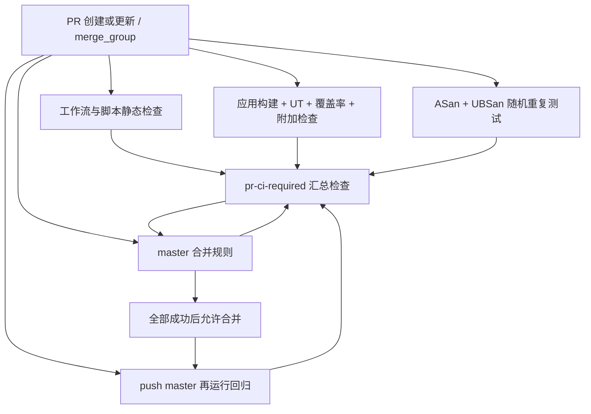

# GitHub PR 合并前 CI 设计

状态：仓库实现已落地；GitHub Actions 与分支保护规则仍需在远端启用。
以本地 `master` 为目标分支；远端默认分支和规则权限需在落地时确认。

## 1. 目标与首期范围

PR 创建或更新后自动验证其与目标分支的合并结果。只有必需检查全部成功，GitHub 才允许
合并；合入目标分支后再执行一次回归。仅配置 Actions 不会自动禁止合并，必须同时配置
Ruleset 或分支保护中的 required status checks。

首期复用已在 Ubuntu 22.04 验证的测试体系：应用构建、UT、行覆盖率至少 95%、
ASan/UBSan、平台与打包脚本静态校验，以及无需外部服务的 Release 安装和集成预检。
真实 IoTDB/FUSE 集成测试安排在独立工作流，先手动或定时运行。

当前基线是提交 `fc02951`：591 项 UT 全部通过，UT 业务代码行覆盖率
3744/3901（96.0%），10 轮随机顺序 ASan/UBSan 通过。这个基线来自本地平台，
在干净 CI 环境中还需要重新建立；不把 591 固定成将来不能增长的测试数量。

## 2. 已确认的落地前置条件

| 事实 | 对 CI 的影响 |
| --- | --- |
| 仓库已包含 `.github/workflows/` 和本地复合 Actions | 工作流已落地；远端现有 Actions 和规则尚未通过认证 API 核验 |
| `third_party/` 被忽略，且没有跟踪文件或子模块 | GitHub checkout 后没有当前本机 SDK |
| 顶层 CMake 无条件查找 FUSE、ecCodes、IoTDB SDK | 即使只构建 `unit_tests`，也必须先提供这些依赖 |
| `init_third_party.sh` 依赖 `/root/auto/iotdb` 和已生成的 Thrift/CMake 文件 | 现有脚本不能直接用于干净 runner 的从零构建 |
| 当前 IoTDB SDK 含 `TSDataType::OBJECT`，`TableSession` 接收裸指针 | 任意官方新版 SDK 不能作为直接替代品 |
| 本机 SDK 需要 `GLIBCXX_3.4.30`，本机 GCC 11 搭配的是较新的 libstdc++ | 必须同时锁定编译器、标准库与 SDK 的 ABI |
| 本次验证使用 ecCodes 2.44.0 及匹配的 definitions/samples | 仅安装 Ubuntu 默认 ecCodes 或只复制动态库不能保证等价 |

最关键的待定项是自定义 IoTDB SDK 的权威源码或可发布制品。这个问题解决前，可以完成
工作流设计，但不能声称已具备可复现、可通过的 GitHub CI。

## 3. 检查拓扑



| job ID | 固定显示名称 | 内容 | 建议超时 |
| --- | --- | --- | --- |
| `workflow_lint` | `pr-workflow-lint` | actionlint 校验工作流；ShellCheck 校验 CI shell 脚本；Python 编译和 CI 回归测试 | 10 分钟 |
| `platform_checks` | `pr-platform-packaging` | 平台配置、发布脚本和测试脚本的语法及 ShellCheck 检查 | 5 分钟 |
| `dependencies` | `pr-dependencies` | 构建并校验固定 SDK、ecCodes、GoogleTest 依赖前缀 | 40 分钟 |
| `linux_ut_coverage` | `pr-linux-ut-coverage` | 构建应用和全部默认测试目标；运行 UT、附加检查、覆盖率门槛 | 30 分钟 |
| `linux_sanitizers` | `pr-linux-sanitizers` | 独立构建目录运行 ASan/UBSan，随机重复 10 轮 | 30 分钟 |
| `linux_release_integration` | `pr-linux-release-integration` | Release 构建、6 项本地集成 harness、临时前缀安装和 Web API smoke | 30 分钟 |
| `ci_required` | `pr-ci-required` | 等待所有阻断 job，仅当结果均为 `success` 时成功 | 3 分钟 |

测试 job 使用固定的 Ubuntu 22.04 x86_64 工具链环境。首期不引入尚未验证的多平台矩阵。
测试 job 并行，依赖使用预先构建且校验通过的固定制品；依赖编译不塞进每个 PR。
超时是初始配置值，需要依据首次冷启动和后续运行数据调整。

`pr-ci-required` 是合并规则唯一必需的检查名。内部 job 可以继续扩展，但汇总检查必须
显式列出所有阻断项，且名字在整个仓库内唯一。

## 4. 触发、检出与失败语义

建议工作流为 `.github/workflows/pr-ci.yml`，触发片段如下：

```yaml
name: PR CI

on:
  pull_request:
    branches: [master]
    types: [opened, synchronize, reopened, ready_for_review, edited]
  merge_group:
    types: [checks_requested]
  push:
    branches: [master]
  workflow_dispatch:

permissions:
  contents: read

concurrency:
  group: pr-ci-${{ github.event_name }}-${{ github.event.pull_request.number || github.ref }}
  cancel-in-progress: ${{ github.event_name == 'pull_request' }}
```

- 使用 `pull_request`，checkout 保留事件默认 ref，验证 GitHub 生成的测试合并提交。
  不指定 PR head SHA 覆盖默认检出行为。
- `edited` 覆盖 PR 修改目标分支的场景。草稿 PR 也运行检查，避免因跳过导致门禁不完整。
- 保留 `merge_group` 触发，即使首期没有启用 merge queue；以后启用队列时验证队列合并提交。
- 只取消同一 PR 的旧运行。不同 PR、push 回归和队列提交不共享取消分组。
- 首期不配置工作流级 `paths`/`paths-ignore`，避免文档 PR 一直缺少 required check。
- 不为必需 job 设置 `continue-on-error`。没有测试、测试失败、超时、取消、意外跳过或缺少
  必需报告均不能成为绿色合并结果。

汇总 job 的核心逻辑如下；所有阻断 job 都必须显式列入 `needs`：

```yaml
ci_required:
  name: pr-ci-required
  needs: [workflow_lint, platform_checks, dependencies, linux_ut_coverage, linux_sanitizers, linux_release_integration]
  if: ${{ always() }}
  runs-on: ubuntu-22.04
  timeout-minutes: 3
  steps:
    - name: Require every check to succeed
      env:
        LINT_RESULT: ${{ needs.workflow_lint.result }}
        PLATFORM_RESULT: ${{ needs.platform_checks.result }}
        DEPENDENCY_RESULT: ${{ needs.dependencies.result }}
        UNIT_RESULT: ${{ needs.linux_ut_coverage.result }}
        SANITIZER_RESULT: ${{ needs.linux_sanitizers.result }}
        RELEASE_RESULT: ${{ needs.linux_release_integration.result }}
      run: |
        for result in "$LINT_RESULT" "$PLATFORM_RESULT" "$DEPENDENCY_RESULT" "$UNIT_RESULT" "$SANITIZER_RESULT" "$RELEASE_RESULT"; do
          test "$result" = success || exit 1
        done
```

这里必须使用 `always()`，否则上游失败可能使汇总 job 被跳过；GitHub 对 skipped 状态的
处理不能替代“所有必需 job 实际成功”的判断。

## 5. 依赖与工具链供应

建议增加独立的 `ci-dependencies.yml`，由受信任分支手动触发依赖更新，产出固定依赖包
或工具链镜像。PR 工作流只下载和校验，使用独立的下载/构建缓存，不持有发布权限。

IoTDB SDK 有两条待选择的供应路径：

| 方案 | 必需输入 | 可提供的保证 |
| --- | --- | --- |
| 自定义源码构建，长期推荐 | 包含 OBJECT 扩展的源码仓库、完整 commit、协议文件和补丁 | 可以追溯源码并从干净环境重建 |
| 固定 SDK 发布包，首期过渡 | 与当前 headers/library 匹配的完整包、允许使用的发布地址、SHA-256 | 可以固定运行依赖；源码来源未补齐前不称为源码可复现 |

现有 `/root/auto/iotdb` 官方源码不能直接认作当前自定义 SDK 的来源。目录名中的
`2.0.5-SNAPSHOT` 也不足以标识一个不可变版本。SDK 发布位置和 PR 读取权限需要明确；
接受 fork PR 时，下载依赖不能依赖 fork 无法取得的仓库 secret。

建议 `ci/dependencies.lock.json` 记录：源码 URL/完整 commit、下载包 SHA-256、SDK 与
Thrift 协议版本、编译器、libstdc++ 版本/ABI、ecCodes、ecbuild、GTest、CMake、gcovr，
以及最终制品的校验值。若采用容器镜像，工作流引用不可变 digest。

首期工具版本参考当前基线：GCC 11、CMake 3.26.5、FUSE 2.9.9、ecCodes 2.44.0、
GoogleTest 1.14.0、gcovr 8.6。标准库必须满足 SDK 的 ABI，不能只锁 GCC 主版本。
ecCodes 的 definitions 和 samples 必须随同一版本安装；构建期使用的 ecbuild 也要固定。

依赖制品应由干净环境重建或核验，不能把整台开发机的 `/root` 或现有 build 目录直接打包。
在应用链接、UT 和 Sanitizer 验证通过之后，才将制品标记为 CI 基线。

## 6. 测试与覆盖率门槛

`linux_ut_coverage` 复用现有项目入口，核心命令为：

```bash
cmake -S . -B build-ci -DCMAKE_BUILD_TYPE=Debug -DBUILD_TESTS=ON \
  -DENABLE_FUSE_INTEGRATION_TESTS=OFF \
  -DIOTDB_ROOT="$IOTDB_SDK_ROOT" \
  '-DCMAKE_CXX_FLAGS=--coverage -fprofile-update=atomic' \
  -DCMAKE_EXE_LINKER_FLAGS=--coverage
cmake --build build-ci -j 4
ctest --test-dir build-ci -L unit --no-tests=error --output-on-failure -j 4 \
  --output-junit ut-results.xml
ctest --test-dir build-ci \
  -R '^(WebApiSmoke|PlatformConfigurationStatic|EnvironmentPreflightHelp)$' \
  --no-tests=error --output-on-failure --output-junit smoke-results.xml
gcovr --root . --filter 'src/' --filter 'include/iotdbfs/' \
  --html-details build-ci/coverage.html \
  --json-summary build-ci/coverage-summary.json \
  --xml build-ci/coverage.xml \
  --txt build-ci/coverage.txt --fail-under-line 95 build-ci/tests/unit
```

`IOTDB_SDK_ROOT`、pkg-config 搜索路径、ecCodes samples/definitions 路径和运行时库搜索
路径由已验证的工具链环境提供。上述命令需配合该环境，不能在缺少 SDK 的 runner 上直接运行。

初始门槛固定为 **95%**，当前 96.0% 作为参考基线；暂不以 100% 阻断合并。
统计范围是 UT 实际编译的业务源文件和 `include/iotdbfs`，不代表全仓库覆盖率。
保存统计范围清单；修改纳入的源文件或过滤规则时，必须在 PR 中解释分母变化。
首次 CI 数据与本地不一致时调查依赖、编译器和范围，不自动降低门槛。

覆盖率仅扫描 UT 对象目录。在运行测试前清除该目录的旧 `.gcda`，运行后再统计新计数。
不得缓存 `.gcda`、测试结果或整个 build 目录。UT 失败必须保留失败状态；若构建成功，可在测试失败后继续生成覆盖率
报告用于诊断，不能用覆盖率成功覆盖测试失败。

报告校验还应确认 UT 数量大于 0、零失败、零禁用/跳过，附加检查恰好为当前三项；Release
报告额外确认预检 CLI、IoTDB 客户端 harness 和通用文件系统 harness 的帮助入口均通过。
不要硬编码 UT 数量为 591；新增或重命名测试后按实际发现结果执行。

`linux_sanitizers` 使用独立 `build-ci-sanitize` 目录：

```text
CMAKE_CXX_FLAGS=-fsanitize=address,undefined -fno-omit-frame-pointer -fno-pie
CMAKE_EXE_LINKER_FLAGS=-fsanitize=address,undefined -no-pie
ASAN_OPTIONS=detect_leaks=1
UBSAN_OPTIONS=print_stacktrace=1:halt_on_error=1
unit_tests --gtest_shuffle --gtest_random_seed=916 --gtest_repeat=10
```

保存完整日志和 GTest XML，检查进程退出码；GTest XML 只记录最后一轮，不能仅凭它证明
10 轮全部通过。第三方未插桩的动态库仍不在 Sanitizer 检查范围内。

## 7. GitHub 合并规则

仓库已提供 `.github/workflows/pr-ci.yml`、`.github/workflows/ci-dependencies.yml`、
三个本地复合 action 和 `ci/` 校验脚本。工作流首次成功后，在 GitHub 为目标分支 `master` 创建或更新一个有效 Ruleset。
用于选择的检查需要在该仓库最近七天内成功运行过：

1. 要求通过 PR 合并，阻止直接推送绕过流程。
2. 开启 required status checks，选择实际由 GitHub Actions 上报的 `pr-ci-required`。
   检查名以首次运行后的 GitHub 界面为准，绑定 GitHub Actions 为预期来源。
3. 首期开启 “Require branches to be up to date before merging”，确保目标分支前进后
   重新验证。以后若启用 merge queue，由队列合并提交的检查保证组合正确性。
4. 禁止强制推送和删除目标分支；检查管理员及其他角色的 bypass 配置，避免门禁失效。
5. 用一个故意失败的试验 PR 验证合并按钮确实被阻止，再恢复为正常测试。

人工审批与 CI 可在 Ruleset 中分开设置；本设计不默认要求单人仓库寻找额外审批人。
CI 成功表示允许按仓库规则合并，不自动开启 auto-merge。

目前 GitHub CLI 未认证，匿名仓库 API 返回 404，因此没有确认远端默认分支、仓库可见性、
已有规则或当前套餐是否支持所需规则。落地时需要具有相应仓库管理权限的已认证会话完成核验。

## 8. 报告、缓存和权限

- 每次运行在 GitHub Job Summary 展示测试数量、失败项、覆盖率分子/分母、工具链版本
  和固定依赖标识。JUnit、Sanitizer 日志、覆盖率 HTML/JSON/XML 作为 artifacts 保存 14 天。
- 报告上传使用失败时仍执行的条件。构建尚未完成导致报告不存在时保留构建日志；
  已进入测试阶段却缺少必需结果文件应报告失败。
- 缓存键包括 runner/架构、工具链或镜像 digest、依赖锁文件哈希、构建模式和编译选项。
  coverage 与 sanitizer 缓存分开；使用 ccache 和依赖下载缓存，不复用覆盖率计数文件。
- 工作流默认 `contents: read`，checkout 不保留推送凭据；Actions 固定到审核过的完整 commit。
  PR 构建不使用 `pull_request_target` 执行 PR 代码，不向 PR 暴露发布或生产凭据。
- 首期 PR 采用 GitHub 托管 runner。需要真实设备或服务的集成工作流另用隔离的临时环境，
  按现有预检程序检查 IoTDB、SchemaRegion、FUSE 和动态库。
- SDK/镜像发布仅由独立依赖工作流执行，其发布权限不传递给 PR 工作流。

## 9. 分阶段落地与验收

| 阶段 | 文件或配置 | 完成条件 |
| --- | --- | --- |
| 依赖基线 | `ci/dependencies.lock.json`、依赖构建/安装脚本、必要时 `ci/Dockerfile` | 没有本机 `/root` 依赖，干净环境能取得并验证 SDK，应用及 UT 构建成功 |
| PR 工作流 | `.github/workflows/pr-ci.yml`、`ci/run_tests.py`、报告校验脚本 | 六个阻断 job 正确运行，失败报告可下载，覆盖率门槛有效 |
| 依赖更新 | `.github/workflows/ci-dependencies.yml` | 依赖可独立更新和验证，固定制品可供 PR 读取 |
| 合并约束 | GitHub Ruleset 或等效分支保护 | 测试失败、覆盖率不足及缺少检查均不能合并 |
| 后续扩展 | 独立真实 IoTDB/FUSE、优化构建或跨平台工作流 | 先建立稳定数据，再决定是否升级为合并阻断项 |

验收至少包括：正常 PR；一个断言失败；覆盖率低于 95%；某个必需 job 被跳过；
只改文档的 PR；连续推送取消旧运行；目标分支前进后重新检查；依赖校验失败；
测试未发现或结果文件缺失。若启用 merge queue，还要验证 `merge_group` 实际上报同名门禁。
如接收 fork PR，也应验证无发布 secret 的完整执行路径。

真实 IoTDB/FUSE 测试仍需独立环境和凭据；自定义 IoTDB SDK 的发布地址与读取权限仍需在
GitHub 仓库变量中配置。

## 参考

- [GitHub Actions 触发事件](https://docs.github.com/en/actions/reference/workflows-and-actions/events-that-trigger-workflows)
- [受保护分支与 required status checks](https://docs.github.com/en/repositories/configuring-branches-and-merges-in-your-repository/managing-protected-branches/about-protected-branches)
- [Required status checks 排查](https://docs.github.com/en/pull-requests/how-tos/merge-and-close-pull-requests/troubleshooting-required-status-checks)
- [Merge queue 配置](https://docs.github.com/en/repositories/configuring-branches-and-merges-in-your-repository/configuring-pull-request-merges/managing-a-merge-queue)
- [本项目 UT 命令](../../tests/unit/README.md)
- [本项目 UT 结果与覆盖率范围](../reports/ut-report-2026-09-15.md)
- [本项目真实集成测试](../../tests/integration/README.md)
