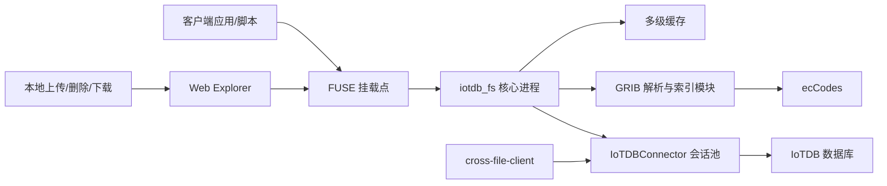

# IoTDB-FS 系统技术设计文档（专利交底版）

## 1. 文档定位

本文档基于当前代码实现整理，面向专利申请前的技术交底与设计归档，目标是把系统的技术方案、数据组织方式、关键流程、核心算法和可保护创新点描述清楚。本文档不是正式权利要求书，但可直接作为说明书、交底书和实施例撰写的基础材料。

系统名称暂定为 **IoTDB-FS**。其核心思想是：以 IoTDB 作为统一持久化后端，把文件系统元数据、原始二进制内容和面向 GRIB 数据的语义索引同时存入同一套时序表中，再通过 FUSE 将其暴露为可挂载文件系统，并在此基础上提供虚拟查询文件、Web 浏览、元数据搜索和跨文件数据导出能力。

## 2. 技术领域

本系统属于时序数据库存储、用户态文件系统、气象 GRIB 数据管理、文件语义查询和科学数据在线处理的交叉技术领域，尤其适用于：

- 气象 GRIB/GRIB2 文件的统一存储与版本管理。
- 基于文件接口的科学数据访问与局部提取。
- 以数据库为后端的文件系统构建。
- 面向元数据检索、裁剪和插值的虚拟文件投影。

## 3. 背景问题

传统 GRIB 文件管理通常存在以下问题：

- 原始文件和元数据分离，文件系统只保存字节流，业务检索需要额外建设索引库。
- 时序数据版本覆盖后难以保留历史版本，回溯与比对成本高。
- 对大体积 GRIB 文件进行局部读取时，通常需要完整下载或依赖独立解析服务，访问路径复杂。
- Web 管理界面、批量检索工具、离线导出工具常常各自维护一套存储访问逻辑，系统重复建设且语义不一致。
- 传统对象存储或数据库后端往往只能提供“整文件读写”，难以把“字节级文件访问”和“消息级 GRIB 查询”统一到同一个接口中。

本系统针对上述问题提出一种统一方案：以“一个逻辑文件版本 = 一个 `(path, time)` 标识”的方式组织数据，在写入阶段同步提取 GRIB 语义信息，在读取阶段通过“路径 + 查询串”构造虚拟文件，从而把文件系统、数据库索引和数据处理流程打通。

## 4. 设计目标

系统的主要设计目标如下：

- 提供标准 POSIX 文件接口，允许业务继续以“目录、文件、读写、重命名、删除”的方式使用系统。
- 把文件元数据、GRIB 文件级元信息、消息级索引和二进制内容统一持久化到 IoTDB。
- 支持文件覆盖时自动生成新版本，避免直接破坏旧数据。
- 支持针对单个 GRIB 文件的消息过滤、二进制提取、数值解码、空间裁剪和双线性插值。
- 通过虚拟文件方式暴露查询结果，使上层程序仍然使用普通文件读取模型。
- 通过扩展属性（xattr）把 GRIB 元数据映射回文件系统，便于检索与外部工具兼容。
- 提供 Web 文件浏览和批量下载能力，但 Web 层不绕过文件系统语义，而是复用挂载目录。
- 对热点路径、原始文件、索引文本、消息数据和解码结果做分层缓存，降低 IoTDB 查询和 ecCodes 解码成本。

## 5. 总体方案

### 5.1 总体架构



### 5.2 可执行组件

| 组件 | 产物 | 作用 |
| --- | --- | --- |
| FUSE 文件系统核心 | `build/bin/iotdb_fs` | 负责挂载目录、处理文件系统调用、与 IoTDB 交互、执行 GRIB 流式索引和虚拟查询读。 |
| Web 文件浏览器 | `build/bin/iotdb_fs_web` | 以 HTTP 方式浏览挂载点、上传文件、创建目录、下载文件、查看元数据、递归检索元数据。 |
| 跨文件导出子命令 | `iotdb_fs cross-file-client` | 直接从 IoTDB 中批量筛选 GRIB 文件，抽取指定消息并导出为 `float32` 数据文件。 |
| GRIB 本地写入工具库 | `src/formats/grib/GribFileWriter.cpp / include/iotdbfs/formats/grib/GribFileWriter.h` | 提供带 GRIB 合法性校验和原子替换语义的本地文件写入辅助能力。 |

### 5.3 关键依赖

- C++17
- FUSE 2.6 接口
- Apache IoTDB C++ TableSession 客户端
- ecCodes GRIB 解析库
- POSIX 扩展属性接口 `getxattr/listxattr`
- 标准 Linux 文件系统能力

## 6. 数据模型设计

### 6.1 核心表设计

系统在 IoTDB 中创建数据库 `dfs`（可配置），核心表为 `inode`。该表既承担文件 inode 元数据存储，也承担 GRIB 元数据、对象内容和索引文本存储。

表结构可抽象为：

| 列名 | 类型 | 角色 | 含义 |
| --- | --- | --- | --- |
| `time` | `TIMESTAMP TIME` | 时间主键 | 文件版本时间戳，同时作为版本标识。 |
| `path` | `STRING TAG` | 标签 | 逻辑绝对路径。 |
| `parent` | `STRING TAG` | 标签 | 父目录路径。 |
| `name` | `STRING FIELD` | 元数据 | 文件名或目录名。 |
| `shortName` | `STRING FIELD` | GRIB 元数据 | GRIB 变量短名。 |
| `is_dir` | `BOOLEAN FIELD` | 元数据 | 是否目录。 |
| `size` | `INT64 FIELD` | 元数据 | 文件大小。 |
| `mode` | `INT32 FIELD` | 元数据 | Unix 权限位。 |
| `uid` | `INT32 FIELD` | 元数据 | 用户 ID。 |
| `gid` | `INT32 FIELD` | 元数据 | 组 ID。 |
| `nlink` | `INT32 FIELD` | 元数据 | 硬链接数。 |
| `ctime` | `TIMESTAMP FIELD` | 元数据 | 创建时间。 |
| `mtime` | `TIMESTAMP FIELD` | 元数据 | 修改时间。 |
| `atime` | `TIMESTAMP FIELD` | 元数据 | 访问时间。 |
| `typeOfProcessedData` | `STRING FIELD` | GRIB 元数据 | 已处理数据类型。 |
| `typeOfGeneratingProcess` | `INT64 FIELD` | GRIB 元数据 | 生成过程类型。 |
| `typeOfLevel` | `STRING FIELD` | GRIB 元数据 | 层次类型。 |
| `centre` | `INT64 FIELD` | GRIB 元数据 | 生产中心。 |
| `generatingProcessIdentifier` | `INT64 FIELD` | GRIB 元数据 | 生成过程标识。 |
| `discipline` | `INT64 FIELD` | GRIB 元数据 | 学科编号。 |
| `parameterCategory` | `INT64 FIELD` | GRIB 元数据 | 参数类别。 |
| `parameterNumber` | `INT64 FIELD` | GRIB 元数据 | 参数编号。 |
| `unit` | `STRING FIELD` | GRIB 元数据 | 计量单位。 |
| `latitudeOfFirstGridPoint` | `DOUBLE FIELD` | GRIB 元数据 | 首网格点纬度。 |
| `longitudeOfFirstGridPoint` | `DOUBLE FIELD` | GRIB 元数据 | 首网格点经度。 |
| `latitudeOfLastGridPoint` | `DOUBLE FIELD` | GRIB 元数据 | 末网格点纬度。 |
| `longitudeOfLastGridPoint` | `DOUBLE FIELD` | GRIB 元数据 | 末网格点经度。 |
| `globalDomain` | `STRING FIELD` | GRIB 元数据 | 全球域信息。 |
| `iDirectionIncrement` | `DOUBLE FIELD` | GRIB 元数据 | 经向步长。 |
| `jDirectionIncrement` | `DOUBLE FIELD` | GRIB 元数据 | 纬向步长。 |
| `Ni` | `INT64 FIELD` | GRIB 元数据 | 经向栅格数。 |
| `Nj` | `INT64 FIELD` | GRIB 元数据 | 纬向栅格数。 |
| `numberOfDataPoints` | `INT64 FIELD` | GRIB 元数据 | 数据点数量。 |
| `data` | `OBJECT FIELD` | 对象内容 | 文件原始二进制内容，支持偏移读写。 |
| `index` | `STRING FIELD` | 索引 | 每个 GRIB 消息一行的紧凑 JSON 索引文本。 |

### 6.2 逻辑文件版本模型

系统并不把“逻辑文件”和“具体版本文件”分成两张表，而是直接把版本信息编码到 `time` 字段中：

- 同一路径 `path` 的不同 `time` 值表示该文件的不同历史版本。
- 读取当前文件时，按 `ORDER BY time DESC, mtime DESC LIMIT 1` 选择最新版本。
- 覆盖写已有文件时，不直接修改旧版本，而是创建一个新的 `time` 值。
- 旧版本在目录中以隐藏文件方式暴露，命名规则为 `.原文件名主干_时间戳.后缀`。
- 例如 `a.grib2` 的旧版本可能显示为 `.a_1713600000000.grib2`。

该设计的优点是：

- 数据天然版本化，无需额外版本表。
- 逻辑路径对用户保持稳定。
- 历史版本可直接被普通文件读取、删除或审计。

### 6.3 GRIB 消息索引格式

索引字段 `index` 为文本拼接形式，每个 GRIB 消息对应一行紧凑 JSON，例如：

```json
{"sn":"t","sr":"0-3","tl":"isobaricInhPa","lv":500,"st":3,"u":"K","gd":"global","ni":1440,"nj":721,"np":1038240,"of":0,"ln":845120,"ed":2}
```

字段含义如下：

| 缩写 | 含义 |
| --- | --- |
| `sn` | `shortName` |
| `sr` | `stepRange` |
| `tl` | `typeOfLevel` |
| `lv` | `level` |
| `st` | `step` |
| `u` | `unit` |
| `gd` | `globalDomain` |
| `ni` | 经向网格数 |
| `nj` | 纬向网格数 |
| `np` | 数据点数量 |
| `of` | 该消息在原始文件中的字节偏移 |
| `ln` | 该消息总字节长度 |
| `ed` | GRIB edition |

该索引既用于虚拟文件查询，也可衍生扩展属性：

- `user.grib.index.keys`
- `user.grib.index.values`

## 7. 核心模块设计

### 7.1 FUSE 文件系统核心

FUSE 核心负责把数据库后端暴露为文件系统，主要操作包括：

| FUSE 操作 | 作用 |
| --- | --- |
| `getattr` | 返回目录、原始文件或虚拟查询文件的属性和大小。 |
| `readdir` | 列出当前目录中的最新文件以及历史版本隐藏文件。 |
| `mkdir` | 创建目录 inode。 |
| `create` | 创建新文件 inode，并初始化对象内容。 |
| `open` | 打开原始文件或虚拟查询文件，构造 `OpenFileCtx`。 |
| `read` | 读取原始字节流、消息二进制子文件或解码后数值子文件。 |
| `write` | 写入原始文件内容，顺序写时触发流式 GRIB 索引。 |
| `release` | 关闭文件并完成索引、元数据和 EOF 记录落库。 |
| `unlink` | 删除当前版本或指定历史版本。 |
| `rmdir` | 删除空目录。 |
| `rename` | 重命名文件或目录；目录重命名时递归更新子路径。 |
| `truncate` | 当前实现仅支持截断为 0，并借此创建新版本。 |
| `getxattr/listxattr` | 以扩展属性形式暴露 GRIB 元数据和索引聚合信息。 |

### 7.2 `OpenFileCtx` 打开文件上下文

每个已打开文件对应一个 `OpenFileCtx` 结构，保存：

- `row_time`、`path`、`parent_path`
- 文件当前长度 `max_pos`
- 原始文件读缓存
- 已加载索引文本和待刷新的索引行
- 待批量落库的对象写入块
- 虚拟二进制子文件的偏移和长度
- 虚拟数据子文件的缓存内容
- 顺序写入统计信息
- `GribWriteStreamer` 流式写入器

该上下文保证一次文件会话中的状态集中管理，使得顺序写入、延迟刷库、缓存复用和关闭收尾逻辑可在同一对象上完成。

### 7.3 IoTDB 会话池

`IoTDBConnector` 对 IoTDB TableSession API 做了薄封装，并实现阻塞式会话池：

- 进程初始化时按配置建立固定数量会话。
- 每个查询、非查询 SQL、Tablet 插入都会从池中租借一个会话。
- 使用 RAII `Lease` 对象在作用域结束时自动归还会话。
- 池初始化时自动执行 `CREATE DATABASE IF NOT EXISTS` 和 `USE db`。
- 写入失败时会记录详细的 `BatchExecutionException` 或 `ExecutionException` 状态，便于定位 IoTDB 侧错误。

该设计避免频繁建连，也避免多个线程直接共享同一个 TableSession。

### 7.4 inode 元数据缓存

`InodeCache` 是线程安全的写回缓存，负责减少数据库读取并合并元数据更新：

- 键为规范化路径 `path`。
- 支持单路径读取、子目录读取、更新、删除和整棵子树删除。
- 对目录子项列表维护 `children_cache_`。
- 脏数据按 `flush_interval` 延迟刷库。
- 非脏项超过容量后按最近最少访问原则淘汰。

该缓存既服务普通文件系统操作，也服务版本文件与目录遍历。

### 7.5 原始文件、索引和解码结果缓存

系统构建了分层缓存体系：

| 缓存 | 键 | 内容 | 目的 |
| --- | --- | --- | --- |
| `RawFileCache` | `row_time|path` | 整文件原始字节 | 命中小文件整读场景，减少反复 `READ_OBJECT`。 |
| `OpenFileCtx::ReadCache` | 相对偏移 | 单次会话中的块缓存 | 优化顺序或局部读。 |
| `IndexCache` | `row_time|path` | 索引文本和查询命中的 `MsgInfo` | 减少索引字符串解析开销。 |
| `DecodedDataCache` | `row_time|path|query` | 解码、裁剪或插值后的结果字节 | 复用虚拟数据文件读取。 |
| `grib_utils::MessageCache` | `cache_token|off|len` | 单条 GRIB 消息原始字节 | 避免重复从数据库读取同一消息。 |

这种设计把“元数据缓存”“消息缓存”“整文件缓存”“结果缓存”分开，实现针对不同访问粒度的优化。

### 7.6 GRIB 流式写入与索引模块

`GribWriteStreamer` 是系统的核心创新模块之一，用于在顺序写文件时同步完成二进制存储和 GRIB 语义索引构建。

其工作机制如下：

1. 写入数据块到达后，先放入内存窗口 `window_`。
2. 当窗口累计到阈值后，对窗口内数据做增量扫描，寻找 `GRIB` 消息头。
3. 根据 GRIB edition 1 或 edition 2 的长度字段判断单条消息边界。
4. 若已经得到完整消息，则尝试用 ecCodes 构造 `codes_handle`。
5. 从第一条可解析消息中提取文件级元数据，例如 `shortName`、`typeOfLevel`、经纬范围、栅格尺寸和单位。
6. 为每条完整消息生成一行索引 JSON，写入待刷新的 `index` 缓冲区。
7. 将已确认边界的数据范围按偏移写入 IoTDB 的 `OBJECT` 字段。
8. 文件关闭时补齐剩余字节、刷新索引、写入元数据列并发送 EOF 记录。

其关键特点如下：

- 支持“边写边识别”，不要求文件整体一次性写入完成。
- 对不完整尾部做保留，等后续数据到达后继续识别。
- 若最终无法确认为 GRIB，则自动退化为普通二进制文件存储，不构造 GRIB 索引。
- 顺序写入是优化主路径；非顺序写入仍可落对象内容，但不会即时得到高质量 GRIB 索引。

### 7.7 对象内容写入策略

对象内容通过 IoTDB `Tablet` 插入接口写入 `data OBJECT FIELD`。系统为每次对象追加构造如下语义：

- `offset`：当前数据块对应的文件偏移。
- `bytes`：数据块内容。
- `eof`：是否为结束块。
- `new_size`：若为最终结束块，则携带最终文件长度。

因此，系统实现的不是“整文件覆盖写入”，而是“对象字段的偏移追加/终结式写入”，适合流式上传、分块写入和大文件对象化存储。

### 7.8 虚拟查询文件机制

系统允许用户通过“路径 + 查询串”访问一个并不存在于物理目录中的虚拟文件。例如：

```text
/mnt/dfs/sample.grib2?function=read,type=binary,shortName=t,level=500
/mnt/dfs/sample.grib2?function=read,type=data,shortName=t,level=500
/mnt/dfs/sample.grib2?function=read,type=data,shortName=t,level=500?function=crop,lat0=10,lon0=100,lat1=20,lon1=120
/mnt/dfs/sample.grib2?function=read,type=data,shortName=t,level=500?function=crop,lat0=10,lon0=100,lat1=20,lon1=120?function=interp,interp=bilinear,outNi=256,outNj=256
```

查询语法采用链式函数风格：

- 至少包含一个 `function=read` 片段。
- `read` 负责确定读取类型和消息过滤条件。
- `crop` 负责经纬度裁剪。
- `interp` 负责插值，当前实现为双线性插值。

主要参数如下：

| 参数 | 作用 |
| --- | --- |
| `type=binary` | 返回匹配消息的原始 GRIB 二进制字节。 |
| `type=data` | 返回解码后的数值数组字节。 |
| `shortName`、`typeOfLevel`、`level`、`step`、`stepRange`、`unit`、`globalDomain`、`ni`、`nj`、`edition`、`numberOfDataPoints` | 用于匹配目标消息。 |
| `dtype=f32/f64` | 控制数值数组输出精度。 |
| `lat0/lon0/lat1/lon1` | 指定裁剪窗口。 |
| `interp=bilinear` | 启用双线性插值。 |
| `outNi/outNj` | 指定输出网格尺寸。 |
| `dlon/dlat` | 指定输出经纬步长。 |
| `border=clamp/nan` | 指定边界处理方式。 |

读取时的执行路径如下：

1. 解析查询链，提取 `read/crop/interp` 参数。
2. 从 `index` 文本中匹配目标消息，得到消息偏移和长度。
3. 若 `type=binary`，则把消息对应的原始字节区间暴露为只读文件。
4. 若 `type=data`，则用 ecCodes 解码 `values` 数组。
5. 若开启 `crop`，则根据 GRIB 网格元信息计算裁剪窗口。
6. 若开启 `interp`，则对裁剪后或全场数据执行双线性重采样。
7. 将最终结果以 `float32` 或 `float64` 原始字节流形式返回。

该机制的价值在于：用户仍通过 `open/read` 访问“文件”，但底层读取的其实是消息级或数值级投影结果。

### 7.9 GRIB 元数据与扩展属性映射

系统把 GRIB 元数据反向映射为扩展属性：

- `user.grib.shortName`
- `user.grib.typeOfProcessedData`
- `user.grib.typeOfGeneratingProcess`
- `user.grib.typeOfLevel`
- `user.grib.centre`
- `user.grib.generatingProcessIdentifier`
- `user.grib.discipline`
- `user.grib.parameterCategory`
- `user.grib.parameterNumber`
- `user.grib.unit`
- `user.grib.latitudeOfFirstGridPoint`
- `user.grib.longitudeOfFirstGridPoint`
- `user.grib.latitudeOfLastGridPoint`
- `user.grib.longitudeOfLastGridPoint`
- `user.grib.globalDomain`
- `user.grib.iDirectionIncrement`
- `user.grib.jDirectionIncrement`
- `user.grib.Ni`
- `user.grib.Nj`
- `user.grib.numberOfDataPoints`
- `user.grib.index.keys`
- `user.grib.index.values`

这样，外部程序可以不直接访问数据库，而通过标准 `getxattr/listxattr` 在文件层获得 GRIB 语义信息。

### 7.10 Web 浏览与管理层

`iotdb_fs_web` 不直接访问 IoTDB，而是面向挂载目录工作，保持和 FUSE 层一致的文件语义。

其工作特点如下：

- 通过 `root` 指定浏览根目录，默认指向挂载点。
- 使用一个监听线程和多个工作线程处理 HTTP 请求。
- 对用户传入路径做规范化和前缀检查，避免目录逃逸。
- 对下载、预览和元数据查看操作，允许把 `read_query` 拼接到文件路径末尾，直接访问虚拟查询文件。

主要接口如下：

| 接口 | 作用 |
| --- | --- |
| `/api/list` | 列目录。 |
| `/api/search` | 递归搜索 `.grib2` 文件的扩展属性。 |
| `/api/preview` | 预览原始文件或虚拟查询结果，文本内容直接展示，二进制给出十六进制摘要。 |
| `/api/viewer-info` | 返回下载名、显示路径、大小和元数据展示能力。 |
| `/api/metadata` | 读取并返回扩展属性。 |
| `/api/upload` | 把 HTTP 请求体流式写入目标文件。若根目录是挂载点，则实际进入 FUSE 写流程。 |
| `/api/mkdir` | 创建目录。 |
| `/api/delete` | 删除单文件或目录。 |
| `/api/delete-batch` | 批量删除。 |
| `/api/download` | 下载单文件或虚拟查询结果。 |
| `/api/download-batch` | 把多个文件或多个虚拟查询结果即时打包为 tar 流下载。 |

其中最关键的一点是：**上传、删除、下载和部分查询读取都是针对挂载目录的普通文件操作**。因此 Web 层只是统一的人机入口，而不是另一套并行存储实现。

### 7.11 跨文件导出工具

`cross-file-client` 负责直接从 IoTDB 中批量筛选文件并导出匹配消息：

1. 根据 `path`、`shortName`、版本去重策略等条件筛选 GRIB 文件记录。
2. 对每个文件读取 `index` 文本。
3. 按 `inner-query` 定位目标消息。
4. 解码该消息的 `values` 数组为 `float32`。
5. 可选择写出为本地 `.f32` 文件。

该工具适合批量离线分析、训练样本生成和跨文件比对，不依赖 FUSE 挂载读取路径。

### 7.12 日志与运维脚本

系统日志按级别写入独立目录：

- `logs/debug/debug.log`
- `logs/info/info.log`
- `logs/warn/warn.log`
- `logs/error/error.log`

运维脚本包括：

- `scripts/dev/start.sh`：根据配置读取挂载点并启动 `iotdb_fs`。
- `scripts/dev/stop.sh`：通过 `fusermount` 或 `fusermount3` 卸载挂载点。

## 8. 关键流程设计

### 8.1 系统初始化与挂载流程

1. 读取 `resources/config.properties`、环境变量和默认值。
2. 初始化日志目录和日志级别。
3. 初始化 IoTDB 会话池。
4. 自动创建数据库和 `inode` 表。
5. 若根目录 `/` 不存在，则自动创建根 inode。
6. 启动 FUSE，并默认加上 `kernel_cache` 挂载选项。

### 8.2 新文件创建与上传流程

1. 客户端执行 `create` 或 Web 层将上传内容写入挂载目录。
2. FUSE 创建新的 `Inode` 记录，并用当前毫秒时间作为 `row_time`。
3. 在 IoTDB 中初始化对应对象内容记录。
4. 若后续为顺序写入，则 `GribWriteStreamer` 开始累积数据并增量识别 GRIB 消息。
5. 文件关闭时写入 EOF 标记，刷新索引文本、元数据列和最终文件大小。

### 8.3 已有文件覆盖写入流程

1. 用户以写模式打开现有文件。
2. 系统检查该逻辑路径当前是否已有活跃写者。
3. 若没有，则复制当前 inode 元数据并生成新的 `row_time`，建立新版本。
4. 后续写操作落到新版本中。
5. 老版本仍然保留，并在目录中以隐藏文件形式暴露。

该流程保证“覆盖写 = 新建版本”，而不是就地破坏。

### 8.4 顺序写入与流式索引流程

1. 写入块到达，若偏移等于 `max_pos`，判定为顺序写。
2. 写入器先把数据加入滑动窗口。
3. 到达处理阈值后，扫描完整 GRIB 消息。
4. 已完成消息的原始字节立即按偏移写入对象字段。
5. 同时生成紧凑索引行并加入 `pending_index_lines`。
6. 如可提取文件级元信息，则更新 `inode` 中的 GRIB 列。
7. 关闭文件时强制刷新剩余数据和索引文本。

### 8.5 非顺序写入流程

1. 若写入偏移不是当前末尾，系统判定为随机写。
2. 该数据块直接作为原始对象分块写入 IoTDB。
3. 系统记录告警日志，提示“已退化为原始块写入，不做流式索引”。

该设计适用于顺序上传场景优先优化，同时保留对随机写的基本兼容。

### 8.6 原始文件读取流程

1. 用户打开普通文件路径。
2. 系统优先尝试命中整文件缓存。
3. 若未命中，则依据读偏移和块大小调用 `READ_OBJECT(data, off, len)`。
4. 对小文件或首块整读场景，可提升为整文件预取并放入 `RawFileCache`。
5. 结果通过 `read()` 返回给用户。

### 8.7 虚拟查询文件读取流程

1. 用户打开带查询串的路径。
2. 系统解析函数链并校验 GRIB 扩展名。
3. 从 `index` 文本匹配目标消息。
4. 若为二进制类型，则把消息偏移区间映射为只读子文件。
5. 若为数据类型，则调用 ecCodes 解码值数组。
6. 按需执行裁剪和插值。
7. 将结果缓存，并以普通文件方式返回。

### 8.8 Web 元数据搜索流程

1. 用户在 Web 界面输入 `k1=v1,k2=v2` 形式的元数据查询。
2. 服务端从当前目录递归遍历所有子路径。
3. 仅对 `.grib2` 文件读取扩展属性。
4. 将属性名统一映射为简化键名，例如 `user.grib.shortName -> shortName`。
5. 所有条件同时满足时记为命中。
6. 返回匹配文件列表及属性摘要。

### 8.9 批量下载流程

1. Web 收到多个文件路径和可选 `read_query`。
2. 对每个条目验证路径、文件存在性和非目录约束。
3. 对普通文件直接读取目标路径，对虚拟文件则将查询串拼接到路径后。
4. 逐项构造 tar header，并把内容流式写入 HTTP 响应。
5. 浏览器获得单个 tar 包，其中每个条目都可对应普通文件或虚拟查询结果。

## 9. 核心算法说明

### 9.1 增量 GRIB 消息扫描算法

系统通过扫描字节流中的 `"GRIB"` 魔数识别消息起点：

- edition 2 时，使用第 8 到 15 字节解析 8 字节总长度。
- edition 1 时，使用第 4 到 6 字节解析 3 字节长度。
- 若消息尚未完整到达，则记录 `incomplete_tail`，并把扫描起点保留到下一轮。

该算法适合网络上传、大文件顺序落库和分块写入场景，不需要在内存中完整保留整个文件。

### 9.2 裁剪窗口计算算法

裁剪时，系统依据：

- 首末网格点经纬度
- 经向和纬向步长
- `Ni/Nj`
- 北向南或南向北的纬度排列方向

将用户输入的经纬范围转换为 `(i0, i1, j0, j1)` 整数网格窗口。若经度存在跨域问题，则先做归一化，再计算对应网格索引。

### 9.3 双线性插值算法

插值时，系统首先确定输出网格尺寸：

- 优先使用 `outNi/outNj`
- 若未给出，则按 `dlon/dlat` 推算
- 若仍未给出，则退化为原网格或裁剪后网格尺寸

每个输出点通过输入网格四邻域做双线性插值。边界处理支持：

- `clamp`：超出边界时钳制到最近有效点
- `nan`：超出边界时输出 NaN

### 9.4 索引匹配算法

索引匹配采用逐行扫描 `index` 文本：

1. 对每一行 JSON 解析用户指定的键值。
2. 字符串字段按精确值匹配。
3. 数值字段先转为整数再比较。
4. 首个完整命中的消息立即返回其 `offset` 和 `length`。

该算法避免在 IoTDB 内部建立额外的消息级多值表，降低写入复杂度。

## 10. 关键创新点与技术效果

### 10.1 创新点一：以时序表统一承载文件系统、版本和对象内容

系统把 `time` 用作版本标识，把 `path` 用作逻辑路径，把 `OBJECT` 字段用作原始内容容器，从而在单表中同时表达：

- 目录/文件元数据
- 历史版本
- 原始二进制字节
- GRIB 文件级元数据
- 消息级索引文本

技术效果是显著降低元数据与内容的跨系统一致性问题。

### 10.2 创新点二：顺序写入过程中同步完成 GRIB 语义索引

系统不是在文件上传后再离线解析，而是在写入过程中实时识别完整消息、抽取元数据和生成索引。这使得：

- 大文件可以边写边可查询。
- 不需要额外的异步索引服务。
- 索引和对象内容天然保持版本一致。

### 10.3 创新点三：以虚拟文件方式表达消息提取、裁剪和插值

系统将“查询结果”表现为只读文件，而不是单独的 RPC 结果集。这样做的优势是：

- 上层程序继续用普通文件接口即可消费结果。
- Web、脚本、命令行和第三方程序可以统一访问。
- 文件级权限、缓存和下载链路可直接复用。

### 10.4 创新点四：把数据库中的 GRIB 元数据反向投影到文件系统扩展属性

扩展属性使系统具备：

- 与现有 Unix 工具链的兼容性。
- 无需直接访问数据库即可做元数据浏览。
- 通过 Web 层递归搜索扩展属性实现文件级语义检索。

### 10.5 创新点五：覆盖写自动生成隐藏历史版本

系统采用“逻辑路径稳定、物理版本递增”的模式。其技术效果包括：

- 覆盖写不丢历史。
- 历史版本对普通用户透明，但可随时访问。
- 审计、回滚、回放和差异分析更容易实现。

## 11. 适用场景与实施边界

系统特别适合：

- 数值天气预报产物归档。
- GRIB 文件批量上传和按条件提取。
- 需要同时支持原始文件访问与元数据检索的科研数据平台。
- 需要保留文件历史版本的生产系统。

当前实现边界如下：

- 对 GRIB 文件的最佳写入路径是顺序写入，随机写入虽然可存储，但不会即时形成同等质量的流式索引。
- Web 元数据递归搜索当前主要面向 `.grib2` 文件。
- 虚拟查询文件的函数链当前实现了 `read`、`crop` 和 `interp(bilinear)`。
- 扩展属性依赖挂载环境支持 xattr。

这些边界不会影响方案成立，反而清晰界定了该实现当前最优的应用范围。

## 12. 主要配置项

| 配置项 | 默认值 | 作用 |
| --- | --- | --- |
| `iotdb.host` | `127.0.0.1` | IoTDB 主机地址 |
| `iotdb.port` | `6667` | IoTDB 端口 |
| `iotdb.user` | `root` | 用户名 |
| `iotdb.pass` | `root` | 密码 |
| `iotdb.db` | `dfs` | 数据库名 |
| `iotdb.pool_size` | `16` | 会话池大小提示 |
| `mount.point` | `/mnt/dfs` | 默认挂载点 |
| `web.host` | `127.0.0.1` | Web 绑定地址 |
| `web.port` | `8080` | Web 端口 |
| `cache.decoded.max_bytes` | `512MB` | 解码结果缓存上限 |
| `cache.read.chunk_size` | `1MB` | 读块缓存大小 |
| `cache.read.full_prefetch_max_bytes` | `32MB` | 整文件预取阈值 |
| `cache.raw_file.max_bytes` | `256MB` | 原始文件缓存上限 |
| `writer.db_request_max_bytes` | `20MB` | 单次写入数据库的目标阈值 |
| `inode.cache.capacity` | `16384` | inode 缓存容量 |
| `inode.cache.flush_interval_ms` | `5000` | 脏 inode 延迟刷库周期 |
| `grib.message_cache.max_entries` | `256` | 消息字节缓存条目数 |

## 13. 建议提炼的专利保护点

结合现有实现，建议重点提炼以下专利点：

1. 一种基于时序数据库的版本化文件系统存储方法，其中在同一张表中联合存储逻辑路径、版本时间、对象内容、文件元数据和 GRIB 语义索引。
2. 一种顺序写入过程中同步构建 GRIB 消息索引的方法，包括消息边界增量识别、消息级偏移记录和文件级元数据提取。
3. 一种通过文件路径查询串将 GRIB 局部提取、数值解码、空间裁剪和双线性插值映射为虚拟只读文件的方法。
4. 一种将数据库内 GRIB 元数据反向映射为文件系统扩展属性并据此执行递归文件检索的方法。
5. 一种面向覆盖写的隐藏版本文件暴露机制，其中用户看到的是稳定逻辑文件名，而系统内部自动创建基于时间戳的历史版本并作为隐藏文件提供访问。

## 14. 结论

IoTDB-FS 的本质不是“把文件简单存进数据库”，而是构建了一套统一的科学数据文件语义平台：

- 底层用 IoTDB 管理版本化对象内容和结构化元数据。
- 中间层用 FUSE 保持标准文件系统接口。
- GRIB 专用逻辑在写入时生成语义索引，在读取时形成虚拟查询文件。
- Web 和离线工具复用同一语义，不再各自维护独立的存储访问链路。

从专利角度看，本系统的价值集中在“统一表示”“流式索引”“虚拟文件投影”“版本可见化”和“扩展属性语义检索”五个方面，具备较强的技术方案完整性和较清晰的权利要求拆分空间。
